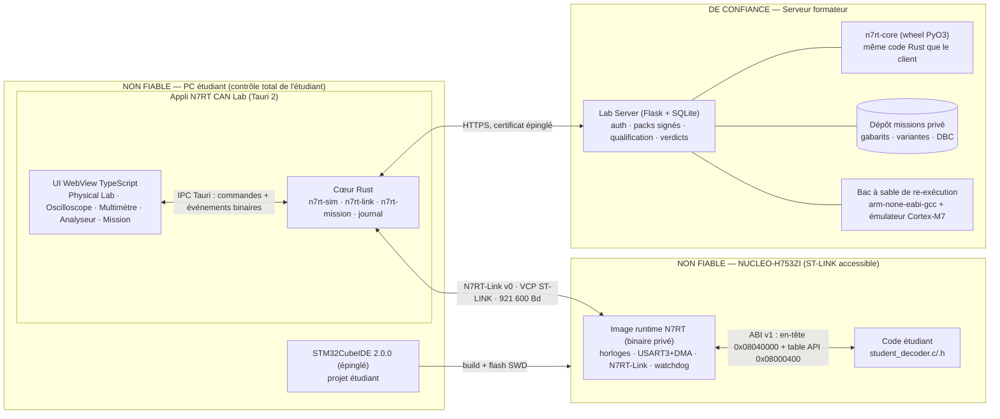

# N7RT CAN Lab — Spécification d'architecture V1

> **Statut** : proposition d'architecture du 2026-10-04. Rien ici n'est validé par l'équipe ; la mise en formation dépend des arbitrages du §16.
> **Distribution livrée** (2026-10-07) : deux dépôts privés (étudiant et encadrant), packs de groupe chiffrés, fichiers d'essai jugés par l'encadrant, oracle privé absent de l'édition publique, aucun serveur. Elle est décrite dans [distribution.md](distribution.md), qui prévaut sur ce plan. Ce document en tient compte en §0 (D6, D7), §2, §3 et §3.1, §4.7, §5, §7, §11 et §16 (A4) ; ailleurs, le serveur formateur reste une proposition non réalisée.
> **Dans le périmètre** : produit, Physical Lab, instruments, simulation spécialisée, intégration CubeIDE/STM32, sécurité pédagogique, cross-platform, première tranche implémentable.
> **Hors périmètre** : implémentation de toutes les missions, SPICE généraliste, protection matérielle irréversible du STM32, vrai bus CAN à cette étape, rédaction du document méthodologique étudiant.
> **Sources vérifiées** (2026-10-04) : l'espace de travail d'origine, avant la séparation en deux dépôts (`tools/stm32` ; `firmware/stm32_h753_bringup`, aujourd'hui dans le dépôt encadrant ; `pc/dashboard`, non publié ; docs du 2026-09-28), et des dépôts de l'équipe (`PoleData_Sept2026`, `Formations`, `BMS`).

---

## 0. Décisions en une page

| # | Sujet | Choix retenu | Écarté | Compromis assumé |
|---|---|---|---|---|
| D1 | Appli étudiant | **Tauri 2** : cœur **Rust** + UI **TypeScript** (Canvas2D) dans la WebView système | Python + navigateur (dashboard actuel) ; Electron ; Qt | Rust est nouveau pour l'équipe ; deux moteurs web (WebView2/Chromium sous Windows, WebKit sous macOS/Linux) |
| D2 | Simulation | Moteur **spécialisé déterministe** en Rust : MNA linéaire par îlots, modèle CAN bit à bit, synthèse des formes d'onde à la demande | ngspice/SPICE ; simulation analogique continue à la nanoseconde | Fidélité limitée aux composants du §10.6 ; validée par lois calculées, propriétés et, plus tard, par le banc réel |
| D3 | Lien PC↔carte | **VCP ST-LINK sur USART3**, protocole binaire **N7RT-Link v0** ([contrat](n7rt-link-v0.md) ; COBS + CRC-32), 921 600 Bd | USB CDC natif (OTG FS) ; JSON Lines actuel | Débit borné à environ 1 500 trames/s ; en échange, un seul câble, et le lien survit à un plantage du code étudiant |
| D4 | Séparation runtime/étudiant | **Image runtime binaire figée** à `0x0800 0000`, ABI par **tables à adresses fixes** ; code étudiant lié par CubeIDE à partir de `0x0804 0000` | `.a` statique classique ; deux ELF flashés séparément | Pas de symboles runtime au débogueur (désassemblage seul) ; script de lien imposé |
| D5 | Isolation sur carte | **V1** : même niveau de privilège, RAM séparées, watchdog, code étudiant désactivé après une faute. **I8** : code étudiant non privilégié + MPU + SVC | MPU dès la tranche 1 | En V1, une écriture sauvage peut corrompre la RAM runtime : c'est détecté (reset), pas empêché |
| D6 | Autorité de validation | **L'encadrant, avec l'oracle privé** (révisé le 2026-10-07) : l'essai nominal de l'étudiant écrit un fichier d'essai `.n7rtrun`, que l'encadrant juge avec l'édition encadrant de l'application ou `n7rt-tool judge` ([distribution.md](distribution.md)). Le serveur formateur proposé le 2026-10-04 (vérité par groupe, vecteurs cachés, verdict, re-exécution du source soumis) n'est pas réalisé | Validation locale dans l'app étudiant ou par la carte : l'édition publique n'affiche aucun verdict | Le fichier d'essai garantit l'intégrité, pas l'authenticité : l'essai décisif se fait en direct devant l'encadrant (§3.1) |
| D7 | Secrets côté client | **Aucun secret dans l'application** (révisé le 2026-10-07). Les paramètres du groupe sont dans son pack de groupe `.n7rtpack`, chiffré par une clé dérivée du code de groupe ; l'oracle est privé et absent de l'édition publique | Mapping en clair ou obfusqué dans le bundle ; tout l'encodage sur serveur | Un étudiant qui détient son pack et son code de groupe **peut déchiffrer le pack hors ligne** (format documenté, crate publique), sans rétro-ingénierie de la mémoire. Il lit le mapping étiqueté de **sa propre** variante et les paramètres du banc, jamais la variante d'un autre groupe ni l'oracle. Accepté : la valeur pédagogique repose sur la logique consommateur (supervision et plausibilité) à implémenter sur la carte, qu'aucun fichier ne donne (§3.1) |
| D8 | Modèle de trame | **Un seul `CanFrame`** (champs de `pc/dashboard/can_model.py`, dashboard de banc non publié) décliné en C, Rust et protocole, prêt pour CAN FD | Un modèle propre à la simulation | Une trame coûte 80 octets côté C même en CAN classique |
| D9 | Bus V1 | CAN 2.0 classique, ID 11 bits, 500 kbit/s, ≤ 8 octets | CAN FD (choix affiché par la formation équipe) | Cohérent avec l'onduleur DTI (2.0B seul) et le repli 2.0B du dictionnaire BMS ; FD déjà porté par le modèle |
| D10 | Outils staff | `stm32lab` et dashboard restent des **outils de banc/staff**, rendus portables | Les fusionner dans l'appli étudiant | Deux familles d'outils (Python staff, Rust étudiant) |

---

## 1. Existant réutilisé (vérifié le 2026-10-04)

État de l'espace de travail d'origine. Depuis la séparation en deux dépôts : `tools/stm32/stm32lab.py` est dans le dépôt étudiant ; `firmware/stm32_h753_bringup` et `docs/hardware-wiring.md` sont dans le dépôt encadrant seulement ; `pc/dashboard` et `pc/control_center` ne sont publiés dans aucun dépôt.

| Élément | Constat (preuve) | Rôle dans le CAN Lab |
|---|---|---|
| `tools/stm32/stm32lab.py` | `detect` (STM32_Programmer_CLI + lecture UID en SWD à `0x1FF1E800`), `build` (presets CMake), `flash` (`mode=UR -w -v -rst`), `smoke-test`, `watch` (décode `RCC_RSR`, reboot, perte USB), `can-link` ; 13 tests ; défauts Windows-only (`C:/ST`, `%LOCALAPPDATA%`, `stm32lab.cmd`) | Outil **staff** : build, flash et validation du runtime, banc, restauration des cartes. Ajouter les sous-commandes `sdk` et `restore` ; porter la découverte d'outils sous macOS/Linux (I12) |
| `firmware/stm32_h753_bringup` | CMake et CubeIDE 2.0.0 sur les mêmes sources, sans `.ioc`. HSI 64 MHz, PLL2 → FDCAN 40 MHz. USART3 à 115 200 Bd, RX en polling, TX bloquant. FDCAN1 à 500 kbit/s, point d'échantillonnage 86,25 %. Ni watchdog, ni caches, ni MPU. HardFault = LED + boucle infinie. `__DATE__/__TIME__` dans l'image ; environ 21–24 Ko | **Base du runtime privé** (BSP, FDCAN, cause de reset). À modifier : UART en DMA, protocole binaire, watchdog, enregistrement de faute, build reproductible |
| `pc/dashboard` | `ThreadingHTTPServer` (bibliothèque standard) + JS vanilla (`innerHTML`, ni canvas ni SVG), SSE ≤ 5/s, `127.0.0.1:8765` ; 27 tests ; sa doc fixe « pas de graphisme en V1 » | Reste le **dashboard de banc staff** |
| `pc/dashboard/can_model.py` | `CanFrame(timestamp, bus, can_id, dlc, payload, flags ext/fd/brs/esi/rtr/err)`, validation DLC/FD, interface `CanSource` | Référence des champs de `n7rt_can_frame_t` (C), `CanFrame` (Rust) et `VCAN_FRAME` (D8) |
| `docs/hardware-wiring.md` | 2× MCP2551, procédure M1–M5 / P1–P4 ; premier essai bus le 2026-09-28 **en échec** (aucun bit dominant émis) | Futur banc de calibration du modèle électrique (I11), une fois réparé |
| `pc/control_center` (PySide6) | Legacy, non installé, aucun lien avec le dashboard | Gelé, non réutilisé |
| Dépôt équipe `PoleData_Sept2026` | Démo FDCAN sur H753ZI (500k/500k BRS, PD0/PD1, HSE 8 MHz) ; D.I.N.O. = Flask + python-can + JS vanilla | Flask pour le serveur proposé (D6, non réalisé) ; HSE 8 MHz pour le runtime |
| Dépôt équipe `BMS` (`docs/10-dictionnaire-can.md`) | ID 11 bits, ordre Intel, compteur 4 bits en octet 6 + CRC8 en octet 7 (proposition v0.1) | Inspire les conventions des **missions fictives** ; le DBC réel n'est **jamais** utilisé |

Écarts à corriger avant réutilisation :
- formats de télémétrie divergents (`ts` en chaîne de caractères) ;
- aucun identifiant de build ;
- fichiers `.launch` verrouillés sur un numéro de série de sonde ;
- makefiles générés par CubeIDE contenant des chemins `C:\…` (ne jamais les livrer) ;
- `stm32lab` (`parse_event`, `smoke-test`, `watch`, `can-link`) et le dashboard (`core.py`) lisent du JSON Lines : ils ne comprendront pas le runtime binaire. Le codec unique `tools/n7rt_link/n7rt_link.py` (S1.1) doit être branché dans `stm32lab` (S1.2b), plutôt qu'un second décodeur. Les images de bring-up JSON restent disponibles pour le banc.

---

## 2. Composants et zones de confiance



**Qui détient quoi**

| Donnée / fonction | Client (appli) | Serveur | Runtime privé (carte) | Code étudiant public |
|---|---|---|---|---|
| Gabarits de mission, DBC, espace de variantes, clé maîtresse de dérivation | — | **seul détenteur** | — | — |
| Paramètres concrets du groupe (encodage, défauts cachés) | chiffrés ; en clair seulement en mémoire du cœur Rust pendant la session | référence | — | — |
| Vecteurs de qualification | les trames, en transit | trames + **valeurs attendues** (n'existent que là) | reçoit les trames | — |
| Verdicts, tentatives, sources soumis | affiche le verdict | **oui** | — | — |
| Modèle physique, instruments, journal | **oui** | — | — | — |
| Transport, protocole, horloges, watchdog | codec côté PC | — | **oui** (binaire sans source) | — |
| API publique `n7rt.h` | — | harnais de re-exécution | implémentation | lecture seule |
| `student_decoder.c/.h` | — | copie soumise | l'appelle | **seule zone modifiable** |

**Distribution livrée.** La zone Z3 et la colonne « Serveur » décrivent le plan : aucun serveur n'est réalisé. La zone de confiance est le dépôt encadrant (gabarits, variantes, clé maîtresse, oracle) avec l'archive des outils encadrant (édition encadrant de l'application, `n7rt-tool` avec l'oracle), jamais remis à un étudiant. Côté étudiant, le pack de groupe et le code du groupe suffisent pour lire **sa propre** variante (D7). Le consommateur de référence, la comparaison d'un essai nominal et le jugement des fichiers d'essai sont dans l'oracle privé, absent de l'édition publique. Détails : §3.1 et [distribution.md](distribution.md).

---

## 3. Frontières de confiance et threat model

**Attaquant.** Un étudiant ou un groupe. Il est administrateur de son PC, possède la carte et le ST-LINK, et maîtrise C/Python. Une minorité sait désassembler ou déboguer un binaire natif. Son but : obtenir un verdict sans faire le travail, ou aider un autre groupe.

**Hors modèle** : compromission du serveur ; attaquant extérieur au cours (seul un durcissement de base est prévu).

**Actifs à protéger**
- A — la vérité de chaque groupe ;
- B — les gabarits, DBC et la clé maîtresse ;
- C — les valeurs attendues en qualification ;
- D — l'intégrité des verdicts ;
- E — la source du runtime ;
- F — la disponibilité des cartes.

Le tableau suit le plan avec serveur. T1 à T3 sont mis à jour pour la distribution livrée ; les protections qui supposent le serveur (T4 à T6, re-exécution de T7 et T8, T9, T10) ne sont pas réalisées : voir §3.1.

| # | Attaque réaliste | Protection | Résiduel accepté |
|---|---|---|---|
| T1 | Lire les fichiers de mission ou le bundle | L'appli n'embarque aucune mission. Chaque groupe reçoit de l'encadrant son pack de groupe `.n7rtpack`, chiffré (AES-256-GCM, clé dérivée du code de groupe par Argon2id), et, séparément, son code. Gabarits, variantes des autres groupes, clé maîtresse et oracle restent dans le dépôt encadrant | Le groupe peut déchiffrer **son** pack hors ligne avec son code (D7, §3.1) |
| T2 | Modifier le bundle (JS) pour afficher le mapping | Les paramètres scellés n'entrent **jamais** dans la WebView : l'UI ne reçoit que ce qu'un instrument mesurerait. Le cœur Rust est natif et strippé ; les snapshots et le journal excluent les paramètres scellés par construction | Inutile pour **son propre** mapping : le groupe le lit dans son pack déchiffré hors ligne, sans débogage (D7). Ni le bundle ni la mémoire de l'appli ne contiennent la variante d'un autre groupe ou l'oracle (absent de l'édition publique) |
| T3 | Copier le `student_decoder.c` d'un autre groupe, ou partager un décodeur « générique » | **Variante par groupe**, stable sur toute la mission : phases, positions et ordre des octets des signaux de valeur, scale et offset (ceux de la base sont chacun conservés avec une probabilité ½), permutation des codes d'état, listes de Data ID, graine de gigue. Identifiants, périodes, DLC, types de protection, longueurs et signes ne varient pas : ils sont communs à tous les groupes. La détection serveur des sources proches et le test I7 relèvent du plan, non réalisé | Un décodeur générique paramétré par le pack déchiffré de chaque groupe est possible (D7). Accepté : la logique consommateur (supervision et plausibilité) reste à écrire et à faire tourner sur la carte |
| T4 | Rejouer d'anciens résultats ou un ancien verdict | Chaque qualification a un `qid` et un nonce frais, avec des vecteurs nouveaux. Les résultats sont liés à `qid` ; le serveur refuse les doublons | — |
| T5 | Fabriquer les résultats côté PC (décodeur Python au lieu du STM32) | Aucune valeur attendue n'est jamais envoyée : forger des résultats revient à décoder correctement. Pour imposer le C sur cible, le serveur **re-exécute le source soumis** sur les mêmes vecteurs (émulateur Cortex-M7, I10). Un écart carte/re-exécution est signalé au formateur | Décoder en Python *et* écrire un C équivalent : acceptable |
| T6 | Utiliser le validateur comme oracle | Retour = PASS/FAIL **par slot**, jamais de valeur. Vecteurs frais à chaque tentative. Limite de cadence (défaut : 1 tentative / 5 min, 10 / session). Tout est journalisé et visible du formateur | Fuite inférieure à 1 bit par slot et par tentative |
| T7 | Patcher l'image runtime du projet (faux résultats, watchdog contourné) | Hash de l'image vérifié à la connexion par défi-réponse avec nonce (§4.7). Lecture flash par ST-LINK en mode staff. La re-exécution serveur rend le patch inutile pour la note | Un runtime patché peut mentir sur son hash (aucune racine de confiance matérielle) |
| T8 | Flasher un firmware qui imite le protocole | Même défense que T5 et T7 | Idem T7 |
| T9 | Écouter le réseau | TLS ; le seul secret qui transite est la clé de session **du groupe** | — |
| T10 | Utiliser la session d'un autre groupe | Codes groupe par session, générés par le formateur et révocables. Jeton lié au `session_id` | Partage volontaire du code (règle de cours) |
| T11 | Lire l'implémentation du transport | Livré en binaire, sans symboles ni source. **La sécurité n'en dépend pas** (Kerckhoffs) | Désassemblage possible ; sans enjeu |
| T12 | Bloquer une carte (option bytes, RDP) | Le projet étudiant n'expose ni option bytes ni horloges. Procédure staff `stm32lab restore` (connect-under-reset, effacement complet, image modèle) | **RDP niveau 2 est irréversible** : l'interdire par consigne. CubeProgrammer reste accessible, et en V1 le code étudiant, privilégié, peut aussi écrire les option bytes (bloqué à partir de I8) |
| T13 | Recopier la fiche ou le diagnostic d'incident d'un autre groupe ; répondre « au plus plausible » sans observer son banc ; rejouer une tentative ou un export | Release 0.3 : chaque incident a plusieurs variantes, tirées par la graine du groupe et scellées dans son seul pack. Un verdict exige ensemble la fiche conforme à **sa** variante, la mesure clé recalculée sur **sa** preuve consignée, la réparation constatée sur son banc et ses sorties STM32 égales à celles de sa variante sur l'essai caché. Chaque tentative porte son nonce, la session, le CRC du code, l'empreinte du banc et celle de ce qui a transité sur le lien ; un nonce rejoué est refusé ; `n7rt-pack verify-export` refuse un export modifié, copié, d'un autre pack ou d'un pack remplacé | Deux groupes tirés sur la même variante d'un incident ont la même vérité de diagnostic, mais chacun répare son banc et fait passer son code ; un groupe qui déchiffre son pack lit sa propre vérité (D7) |

**Ce qui ne peut pas être garanti tant que le ST-LINK est physiquement accessible**
1. **Confidentialité de ce qui est flashé.** RDP 0 est obligatoire pour que l'étudiant flashe, donc le runtime est désassemblable. Il ne contient par conséquent **aucun secret**.
2. **Intégrité du runtime sur la carte.** Il n'y a ni secure boot ni racine de confiance (option bytes et RDP sont hors périmètre et risqués pour la récupération).
3. **Authenticité des résultats « venant de la carte ».**
4. **Lecture par l'étudiant de la RAM de sa propre carte** au débogueur : elle ne peut pas être empêchée.

**Règle de conception qui en découle** : la carte et l'appli sont des **environnements d'exécution**, jamais des ancres de confiance. L'autorité est hors du poste étudiant : dans le plan, le serveur (vérité, vecteurs, verdict, re-exécution) ; dans la distribution livrée, l'encadrant et l'oracle privé (§3.1). Les contrôles locaux (hash, ABI) servent la **compatibilité** et bloquent la **triche triviale**, rien de plus.

### 3.1 Distribution livrée (2026-10-07)

Résumé ; la référence est [distribution.md](distribution.md).
- **Pack de groupe** (`.n7rtpack`) : chiffré par une clé dérivée du code de groupe (16 caractères, remis séparément du pack). Il contient la projection étudiante de la variante du groupe : sa matrice (identifiants, périodes, dispositions, échelles, Data ID, codes d'état), les étiquettes `source` des signaux, les émetteurs des trames, les libellés d'énumération, les qualificatifs, le conditionnement de l'ECU source, le texte du banc avec ses paramètres cachés (identiques pour tous les groupes), les paramètres du scénario nominal et des paramètres consommateur **neutres** : aucun paramètre consommateur de l'oracle n'atteint un étudiant. Il ne contient ni l'oracle, ni les noms et unités des trames et des signaux, ni les règles de comparaison, ni la variante d'un autre groupe.
- **Risque résiduel D7** : un étudiant qui détient son pack et son code de groupe peut déchiffrer le pack hors ligne (format documenté, crate publique, aucun secret dans l'application), sans rétro-ingénierie de la mémoire. Il lit alors le mapping étiqueté de **sa propre** variante et les paramètres du banc, jamais la variante d'un autre groupe ni l'oracle. Accepté : la valeur pédagogique repose sur la logique consommateur (supervision et plausibilité) implémentée sur la carte, qu'aucun fichier ne donne.
- **Oracle** : supervision des messages côté consommateur, logique consommateur de la mission, consommateur de référence, comparaison d'un essai nominal et jugement des fichiers d'essai. Il est privé (dépôt encadrant) et n'est compilé que dans l'**édition encadrant**, construite par les encadrants. L'**édition publique** (version étudiante) n'affiche aucun verdict et refuse le jugement ; des substituts publics (`app/crates/n7rt-vehicle/src/public/`) tiennent sa place : le VCU d'arrière-plan lit la course du premier canal capteur décodée du bus, sans jamais couper ni superviser. Le côté émetteur de la protection E2E reste public : le véhicule simulé en a besoin.
- **Fichier d'essai** (`.n7rtrun`) : JSON canonique avec un champ `integrity` (SHA-256), qui garantit l'intégrité, pas l'authenticité. Un étudiant qui a implémenté la logique ailleurs pourrait fabriquer un fichier d'essai réussi sans carte. Parade : l'essai décisif se fait en direct devant l'encadrant ; le fichier enregistre l'UID de la carte, le build du runtime et le CRC-32 du code étudiant, pour recoupement.
- **Mode encadrant** : le code encadrant est vérifié contre `instructor/auth.json` du dossier encadrant configuré. N'importe qui peut créer un dossier encadrant et entrer en mode encadrant : cela ne donne rien (ni pack de référence, ni clé maîtresse, ni oracle dans l'édition publique). La vraie frontière est l'accès au dépôt encadrant et à l'archive des outils encadrant.
- **Verrou du choix de mission** : une commodité de l'interface, stockée dans le profil de l'étudiant (`%APPDATA%\fr.n7rt.canlab\student\state.json`) ; supprimer ce fichier déverrouille. Un pack de groupe n'ouvre que la mission pour laquelle il a été généré.

---

## 4. Embarqué : runtime privé et code étudiant

### 4.1 Principe : deux images dans un même ELF
- **Le runtime est lié à part.** C'est un ELF complet placé à `0x0800 0000`, qui embarque sa propre newlib-nano. Il est converti en blob binaire (`n7rt_runtime_image.o`, section `.n7rt_runtime`), donc ses octets sont **identiques quel que soit le code étudiant**, ce qui permet de le vérifier par hash.
- **Le build CubeIDE de l'étudiant** lie `student_decoder.c`, la glue `libn7rt_student.a` (en-tête étudiant + veneers d'API) et sa propre newlib-nano dans la zone étudiante. Le blob runtime est inclus tel quel. Le flash CubeIDE écrit le tout d'un coup, donc l'image est toujours cohérente.
- **Recette de lien imposée** par le `.ld` et les options du projet :
  - `EXTERN(n7rt_student_header)` : sans référence, `ld` n'extrait pas le membre de l'archive qui contient l'en-tête, et `KEEP()` ne suffit pas ;
  - `ENTRY(n7rt_reset)`, où `n7rt_reset` est le vecteur de reset du blob, écrit dans le `.ld` par `stm32lab sdk` ;
  - `-nostartfiles` : pas de `crt0`, donc pas de `main` requis.
  - Le `Reset_Handler` du runtime charge lui-même MSP, car un `load` GDB positionne PC sans recharger SP.
- **Aucun lien symbolique entre les deux images.** Le runtime appelle l'étudiant via l'en-tête à adresse fixe ; l'étudiant appelle le runtime via la table d'API à adresse fixe (V1) ou SVC (I8). Conséquence : la version de GCC de l'étudiant (13.3 dans CubeIDE 2.0.0) n'importe pas, seul l'AAPCS compte : `-mcpu=cortex-m7 -mthumb -mfpu=fpv5-d16 -mfloat-abi=hard`.

### 4.2 Plan mémoire (STM32H753ZI)

| Zone | Adresses | Taille | Contenu | Propriétaire |
|---|---|---|---|---|
| Flash banque 1, secteurs 0–1 | `0x0800 0000–0x0803 FFFF` | 256 Ko | Image runtime : vecteurs, **table API v1 à `0x0800 0400`**, code, rodata, init `.data` | runtime (blob figé) |
| Flash banque 1, secteurs 2–7 | `0x0804 0000–0x080F FFFF` | 768 Ko | **En-tête étudiant à `0x0804 0000`**, code et rodata étudiant, newlib étudiante | étudiant |
| Flash banque 2 | `0x0810 0000–0x081F FFFF` | 1 Mo | Réservée (inutilisée en V1) | — |
| AXI SRAM (D1) | `0x2400 0000–0x2407 FFFF` | 512 Ko | Runtime : **pile principale en bas de zone** (un débordement tombe dans la zone réservée sous `0x2400 0000` → BusFault, pas de corruption silencieuse), `.data/.bss`, buffers DMA UART, file de trames, `.noinit` (enregistrement de faute) | runtime |
| DTCM | `0x2000 0000–0x2001 FFFF` | 128 Ko | Étudiant : `.data/.bss`, tas borné à 8 Ko (`_sbrk` de la glue ; nécessaire au formatage `%f` de newlib-nano), pile PSP en I8 | étudiant |

Le script `N7RT_H753_student.ld` vérifie au lien :
- `ASSERT(ADDR(.n7rt_student_header) == 0x08040000)` ;
- la taille de `.n7rt_runtime` ≤ 256 Ko ;
- l'absence de débordement des zones étudiantes.

Une erreur ABI donne donc une **erreur de build CubeIDE explicite**, pas une carte muette.

### 4.3 ABI v1
- **En-tête étudiant** (`0x0804 0000`, 64 octets dont 44 utiles et une réserve nulle, défini dans la glue) :
  - `magic 'N7ST'`, `abi_major/abi_minor` ;
  - pointeurs `init`, `on_frame`, `on_tick` ;
  - bornes `.data` (chargement et exécution) et `.bss` ;
  - fin de zone étudiante (pour le CRC).
- **Table API v1** (`0x0800 0400`, dans le blob) : `abi_major/minor` puis des pointeurs de fonctions en ordre figé, **en ajout seul**.
- **Règles de compatibilité**
  - Types à largeur fixe, jamais d'`enum` ni de `bool` dans une structure d'ABI (leur taille dépend des options GCC) ; les `_Static_assert` sur `sizeof`/`offsetof` sont dans l'en-tête public.
  - `abi_major` différent → refus ; `abi_minor` supérieur côté étudiant → refus.
  - Le runtime ne déréférence aucun pointeur de l'en-tête sans vérifier qu'il tombe dans la zone étudiante.

### 4.4 API publique (seul contenu visible de `n7rt/include/n7rt.h`)
```c
typedef struct {
    uint64_t timestamp_us;  /* instant de réception, temps du bus (µs depuis le début de session) */
    uint32_t id;            /* identifiant 11 bits, ou 29 bits si N7RT_CAN_EXT */
    uint8_t  dlc;           /* code DLC tel que transmis (0..15) */
    uint8_t  len;           /* nombre d'octets valides dans data[] (0..64) */
    uint8_t  flags;         /* N7RT_CAN_EXT 0x01 | _RTR 0x02 | _FD 0x04 | _BRS 0x08 | _ESI 0x10 (n7rt-link-v0 §8.3) */
    uint8_t  bus;           /* 0 en V1 */
    uint8_t  data[64];
} n7rt_can_frame_t;         /* 80 octets, layout figé par _Static_assert */

/* À fournir par l'étudiant (student_decoder.c) — appelées hors interruption, jamais en concurrence */
void student_init(void);
void student_on_frame(const n7rt_can_frame_t *frame);
void student_on_tick(uint64_t now_us);          /* toutes les 10 ms de temps bus */

/* Services du runtime */
void     n7rt_publish(uint8_t slot, float value); /* valeur physique décodée pour un slot de la mission */
void     n7rt_reject(uint8_t slot);               /* « trame non exploitable pour ce slot » */
uint64_t n7rt_now_us(void);                       /* temps du bus */
void     n7rt_log(const char *text);              /* ≤ 120 caractères, 20 lignes/s max */
/* I4+ : int n7rt_can_get_status(n7rt_can_status_t *s);  V2 : int n7rt_can_send(const n7rt_can_frame_t *f); */
```

Choix pédagogiques de cette API :
- `n7rt_reject` ne prend **pas de motif** : une énumération du genre « checksum faux » révélerait la présence d'un checksum.
- Les slots sont définis par l'énoncé public (« slot 0 = position pédale, % »), jamais par l'encodage.
- Ce fichier ne contient aucun exemple de décodage.
- Au plus 8 publications par trame ; au-delà, elles sont ignorées et `RESULT` porte un drapeau de débordement.
- `float` suffit, car les signaux des missions V1 sont limités à 16 bits utiles : la tolérance de ½ LSB reste tenable après scale/offset.
- Pas de drapeau `err` : comme avec un vrai FDCAN, les trames d'erreur ne sont jamais livrées au code étudiant (elles restent visibles à l'analyseur).

### 4.5 Cycle de vie
1. **Boot** : `Reset_Handler` (runtime), puis :
   - init de la RAM runtime ;
   - horloge système dérivée de HSE 8 MHz (MCO du ST-LINK, comme la démo équipe) ;
   - USART3 en DMA (RX circulaire + IDLE, TX en anneau) ;
   - IWDG à 2 s, **gelé quand le cœur est arrêté par le débogueur** (bit `DBG_IWDG1` de `DBGMCU`) : sans ce gel, un point d'arrêt CubeIDE de plus de 2 s provoquerait un reset ;
   - SHA-256 de l'image runtime par le périphérique HASH du H753 ;
   - contrôle de l'en-tête étudiant ;
   - émission spontanée de `HELLO_ACK(reason=boot)`.
2. **En-tête valide** : copie `.data`, mise à zéro `.bss`, `student_init()`. **En-tête absent ou invalide** : le lien reste opérationnel et `HELLO_ACK` en donne le motif, donc la carte reste pilotable.
3. **`SESSION_START`** : réinitialise la RAM étudiante et rappelle `student_init()` **sans reset carte**. En V1, cela ne garantit pas un état connu, car le code étudiant, privilégié, peut avoir modifié des périphériques. Une qualification commence donc toujours par `RESET_REQ`, puis `SESSION_START`.
4. **Faute ou watchdog pendant un hook** :
   - le handler runtime, écrit en assembleur, **bascule d'abord MSP sur une pile de secours** (sinon un débordement de pile ferait fauter le handler lui-même, d'où un lockup). Il enregistre ensuite CFSR, HFSR, MMFAR, BFAR, PC, LR et le hook en cours dans `.noinit`, puis fait un reset ;
   - au reboot, le code étudiant est **désactivé** jusqu'à un `SESSION_START` explicite ou une nouvelle image étudiante (CRC différent). L'appli ne relance **pas** la session automatiquement : elle affiche le rapport brut, comme le Fault Analyzer de CubeIDE, et propose « Relancer ». Il n'y a donc pas de boucle faute → reset.
5. **Mesures** : le temps de chaque hook est mesuré par DWT `CYCCNT` et renvoyé dans `RESULT`. Il faut déverrouiller `DWT->LAR` quand aucun débogueur n'est attaché. Le budget par défaut est de 200 µs par trame (dépassement signalé, pas sanctionné).
6. **Heartbeat** : émis par une **interruption timer**, pas par la boucle principale, et porteur de `hook_running_ms`. L'IWDG, lui, n'est rafraîchi que par la boucle principale. On distingue ainsi :
   - point d'arrêt : plus aucun heartbeat ;
   - boucle infinie dans le code étudiant : heartbeats avec `hook_running_ms` croissant, puis reset IWDG à 2 s, avec enregistrement de faute.

### 4.6 Isolation : V1 puis I8

**V1 (tranche 1)**
- Même privilège pour runtime et étudiant.
- RAM séparées, pile runtime protégée par la zone réservée, IWDG, désactivation après faute.
- Objectif atteint : jamais de carte « morte » ; récupération = bouton RESET ou un re-flash CubeIDE.
- **Résiduel V1** : le code étudiant, privilégié, peut écrire les registres FLASH et les option bytes, jusqu'au RDP 2 irréversible. C'est interdit par consigne, et bloqué par MPU à partir de I8.

**I8**
- `student_*` tourne en Thread non privilégié, sur PSP en DTCM.
- MPU (16 régions sur H7) : runtime en accès privilégié seul, DTCM en accès non privilégié, périphériques interdits.
- Les veneers de `libn7rt_student.a` deviennent des `svc` : **même source étudiant**, simple recompilation.
- Watchdog de hook par SysTick et abandon logiciel du hook **sans reset**.

Aucune option byte n'est touchée, à aucun moment : la récupération reste un flash ordinaire.

### 4.7 Production, distribution et vérification du runtime
- **Sources privées du runtime**, dérivées du bring-up (réalisé : `firmware/stm32_h753_bringup/runtime/`, dans le dépôt encadrant seulement) : build CMake avec le toolchain épinglé (bundle GCC 14.3.1 déjà utilisé par `stm32lab`). Build **reproductible** :
  - suppression de `__DATE__/__TIME__` ;
  - `-ffile-prefix-map` ;
  - `build_id` = hash du commit.
- **`stm32lab sdk`** (nouvelle sous-commande) :
  1. build ;
  2. `objcopy -O binary` ;
  3. SHA-256 ;
  4. génération de `n7rt_runtime_image.o` (`objcopy -I binary -O elf32-littlearm`, section `.n7rt_runtime`, placée par `KEEP()` dans le `.ld` pour survivre à `--gc-sections`) ;
  5. compilation de la glue en `-g0`, avec seuls les symboles publics gardés globaux ;
  6. copie des en-têtes et du `.ld` ;
  7. écriture de `manifest.json` `{runtime_version, abi, image_sha256, build_id, toolchain}`, signé Ed25519.
- **Vérifications, dans l'ordre où elles interviennent**

  | Moment | Contrôle | Effet en cas d'échec |
  |---|---|---|
  | Build CubeIDE | `ASSERT` du `.ld`, `_Static_assert` de l'ABI | Erreur de build lisible |
  | Boot | Magic, ABI, bornes de l'en-tête étudiant | Code étudiant non lancé ; lien actif |
  | Connexion appli | `HELLO(nonce)` → la carte répond `SHA-256(nonce ‖ image runtime)`. L'appli recalcule avec les images de référence du manifeste signé (images publiques, aucun secret) | Mission refusée avec un message fixe : « runtime absent ou modifié : reconstruisez le projet modèle sans toucher `n7rt/` » |
  | Qualification | Le serveur revérifie version, build_id et réponse au défi, puis re-exécute le source | Verdict signalé au formateur |
  | Staff (option) | `stm32lab` lit la flash par ST-LINK et compare au manifeste, sans la coopération du runtime | Carte marquée pour restauration |

  **Portée réelle de ces contrôles** : le hash couvre le **blob runtime**. Une modification de la glue, du `.ld` ou de `n7rt.h` n'est pas détectée de façon fiable (seulement par les contrôles d'ABI). C'est sans effet sur la note : le serveur re-exécute le source avec ses propres fichiers (plan ; sans serveur, l'essai décisif se fait en direct devant l'encadrant, §3.1).

---

## 5. Expérience de programmation de l'étudiant

Le parcours principal intégré est **Code STM32 → Enregistrer → Compiler → Flasher → Cockpit** (§5.1). L'expérience CubeIDE décrite ci-dessous reste disponible pour le débogage accompagné. Sa commande Run utilise son propre programmateur : elle ne bénéficie pas du contrôle de zone étudiante du flasher intégré.

**Livrable** : `N7RT_CANLab_Student_v<runtime>.zip`, distribué par le serveur (plan). Réalisé : le projet `N7RT_CANLab_Student/` est livré dans l'archive étudiante ([distribution.md](distribution.md)) ; son contenu réel est décrit dans [n7rt-student-sdk-v0.md](n7rt-student-sdk-v0.md).

```
N7RT_CANLab_Student/
  .project  .cproject                 # 1 configuration « N7RT » (-O0 -g3 -Wall -Wextra), chemins relatifs uniquement
  N7RT_Run.launch                     # ST-LINK GDB server, SWD, connect-under-reset, SANS numéro de série figé,
                                      # arrêt initial sur student_init (l'ELF étudiant n'a pas de main)
  student/student_decoder.c           # ← SEUL fichier à modifier (gabarit : fonctions vides)
  student/student_decoder.h           # ← déclarations privées de l'étudiant
  n7rt/include/n7rt.h                 # API publique (lecture seule)
  n7rt/lib/libn7rt_student.a          # glue : en-tête étudiant + veneers (sans symboles internes)
  n7rt/lib/n7rt_runtime_image.o       # blob runtime (aucun symbole, aucune source)
  n7rt/ld/N7RT_H753_student.ld
  LISEZMOI.txt                        # 5 étapes, aucune aide de décodage
```

**Parcours (identique sur les 3 OS)**
1. *File → Import → Existing Projects into Workspace → Select archive file*. Mettre à jour le firmware ST-LINK si CubeIDE le propose (cas déjà rencontré sur ce banc).
2. Ouvrir `student/student_decoder.c`.
3. **Build** : le gabarit compile avec 0 erreur et 0 avertissement.
4. **Run** : flash et reset ; l'appli détecte le boot en moins de 3 s.
5. **Debug** : points d'arrêt, pas à pas et variables dans le code étudiant. Le runtime n'apparaît qu'en désassemblage. Quand la cible est arrêtée, l'appli affiche « cible arrêtée » et suspend l'envoi des trames, sans conclure à un plantage.

**Règles**
- Seuls `student/student_decoder.c/.h` comptent : ce sont les deux fichiers soumis et re-exécutés dans le plan avec serveur (dans la distribution livrée, aucun serveur ne les re-exécute : le fichier d'essai enregistre le CRC-32 du code étudiant compilé, rapporté par la carte). Le dossier source du projet se limite à `student/`.
- `n7rt/` est en lecture seule (attribut fichier). Un blob runtime modifié est refusé au handshake. Une modification de la glue, du `.ld` ou de l'en-tête n'est pas détectée de façon fiable (§4.7).
- Les erreurs de compilation et de lien sont celles de GCC, sans filtre.
- Ne jamais livrer `Debug/` ni de makefiles générés (ils contiennent des chemins absolus).

### 5.1 Page de code intégrée au CAN Lab

L'extension du 2026-10-08 ajoute un parcours d'édition dans l'application, à côté du Cockpit et du Physical Lab. Elle utilise le même SDK public et ses deux fichiers étudiants ; CubeIDE reste la voie pour le débogage avec points d'arrêt. Le parcours et les captures sont documentés dans [le tutoriel du mini-IDE](inapp-student-ide-tutorial.md), les preuves de validation dans [le rapport R1](inapp-student-ide-r1.md).

Le backend conserve les sources dans le profil local. Les gabarits du SDK sont embarqués et protégés. Modifier les sources invalide le build précédent ; la programmation exige une image valide de la révision actuelle, une carte connectée et un runtime vérifié. Le helper Python construit avec la chaîne GCC ARM installée et programme avec STM32CubeProgrammer uniquement la zone étudiante. L'application libère le port puis contrôle l'UID, le runtime et le CRC à la reconnexion. Une session ou un essai nominal en cours interdit la programmation.

La release doit transporter le helper et ses dépendances locales avec le SDK. Python 3.11+, `pyserial`, GCC ARM et STM32CubeProgrammer sont les prérequis du poste. Le contrôle de l'image et l'écriture limitée ne constituent pas une sandbox du C étudiant à l'exécution : l'isolation MPU/SVC reste l'évolution I8.

---

## 6. Protocole N7RT-Link v0 (PC ↔ runtime)

Le contrat est figé dans [n7rt-link-v0.md](n7rt-link-v0.md), qui **fait foi** : tramage, messages, séquencement, délais, erreurs, VirtualCanFrame. Il est exécutable :
- codec public, tests de propriétés et outil de layouts/budget : `tools/n7rt_link/` (`python tools/n7rt_link/protocol_docs.py check-doc`, `python -m pytest tools/n7rt_link/tests`) ;
- conformité exacte CRC/COBS/paquets/flux : `tools/conformance/n7rt_link/` du dépôt encadrant, sans fixture de réponse dans le dépôt/build étudiant.

Résumé non normatif :
- **Tramage** : VCP ST-LINK ↔ USART3, 921 600 Bd 8N1. COBS canonique + délimiteur `0x00`. En-tête de 6 octets (`proto` = 0, `type`, `seq`, `len` ≤ 255), CRC-32/ISO-HDLC, little-endian.
- **Messages v0** :
  - `HELLO`/`HELLO_ACK` : identité, ABI, défi d'intégrité ;
  - `SESSION_START`/`SESSION_STOP`/`SESSION_ACK`, `RESET_REQ` ;
  - `VCAN_FRAME`, qui reçoit exactement un `RESULT` ou un `NACK` ;
  - `SIM_TIME`, qui déclenche des `TICK_RESULT` ;
  - `STUDENT_LOG`, `FAULT_REPORT`, `HEARTBEAT`, `NACK`.
  - Types réservés : `VCAN_STATUS` (I4), `VCAN_TX` (V2).
- **Flux** : crédits `W` annoncés par la carte, aucune retransmission de trame, PC muet en `STALLED`.
- **Débit, vérifié par un test de calcul** au plafond V1 de **600 trames/s** sur le bus (≈ 13–16 % de charge à 500 kbit/s), au pire cas :
  - PC → carte : 28,3 % du lien ;
  - carte → PC : 57,6 % ;
  - le lien tient 1 150 trames/s dans les deux sens (1,92 × le plafond).
  La mesure réelle sur carte reste à faire (S1.2).

---

## 7. Flux runtime : build → flash → run → measure → submit

Flux du plan avec serveur, non réalisé. Flux livré ([distribution.md](distribution.md)) : l'étudiant choisit la mission, importe son pack de groupe et saisit son code ; l'essai nominal écrit un fichier `.n7rtrun`, remis à l'encadrant qui le juge ; aucun verdict n'est affiché à l'étudiant.

```mermaid
sequenceDiagram
  autonumber
  actor E as Étudiant
  participant IDE as CubeIDE
  participant B as NUCLEO (runtime + étudiant)
  participant A as Appli CAN Lab
  participant S as Serveur
  E->>A: connexion (code groupe de la séance)
  A->>S: login → jeton ; pack mission signé + clé de session (mémoire seule)
  E->>IDE: édite student_decoder.c → Build → Run
  IDE->>B: flash SWD + reset
  B-->>A: HELLO_ACK(reason=boot, RCC_RSR, dernière faute)
  A->>B: HELLO(nonce)
  B-->>A: HELLO_ACK(version, ABI, H(nonce‖image), en-tête étudiant)
  A->>A: contrôle manifeste → READY ou refus explicite
  A->>B: SESSION_START(exploration)
  loop temps réel (simulation maîtresse du temps)
    E->>A: pot, fils, R/C, débit, instruments
    A->>B: VCAN_FRAME(seq, t_us, trame) · SIM_TIME
    B-->>A: RESULT(seq, publications, cycles)
    A-->>E: mesures, trames, valeurs publiées par la carte
  end
  E->>A: Soumettre
  A->>S: demande de qualification
  S-->>A: qid, nonce, vecteurs cachés (trames + temps, aucune valeur)
  A->>B: RESET_REQ, puis SESSION_START(qualification), VCAN_FRAME… au rythme des crédits
  B-->>A: RESULT…
  A->>S: résultats + student_decoder.c/.h + infos HELLO_ACK
  S->>S: comparaison à la vérité (tolérance) + re-exécution (I10)
  S-->>A: verdict PASS/FAIL par slot — jamais de valeur attendue
```

---

## 8. Application étudiant : architecture interne

- **Processus**
  - Cœur Rust (process Tauri) avec un thread par sous-système :
    - `sim` (pas logique de 1 ms, cadencé sur l'horloge monotone) ;
    - `scope` (calcul des acquisitions) ;
    - `link` (port série) ;
    - `mission` (HTTPS) ;
    - `journal` (écritures disque).
  - La WebView tourne dans son propre processus sur les 3 OS.
  - Une `panic` dans un sous-système est rattrapée par `catch_unwind` (la CI vérifie `panic = "unwind"`). Le sous-système redémarre depuis le dernier snapshot plus la queue du journal.
    - **La dernière transaction est mise en quarantaine**, sinon le rejeu déterministe reproduirait la panique.
    - Au plus 3 redémarrages, puis retour à l'écran de session.
    - L'état restauré est exact parce que l'ordre d'assemblage des îlots et des matrices est **canonique** : identique depuis un snapshot ou pas à pas.
  - Débordement de pile, OOM et `abort` ne se rattrapent pas dans le processus : le journal sur disque permet la reprise au relancement. Si cela ne suffit pas en pratique, le moteur passe dans un processus fils (sidecar).
- **IPC**
  - UI → cœur : commandes typées (`edit`, `instrument`, `run_control`, `mission`).
  - Cœur → UI :
    - deltas d'état à ≤ 30 Hz ;
    - lots de trames pour l'analyseur à 20 Hz ;
    - acquisitions oscilloscope en **binaire** (colonnes min/max en `Float32Array`, ≤ 2 × 2 000 colonnes par voie), jamais en JSON.
- **UI**
  - TypeScript compilé par Vite. Pas de framework lourd (un framework léger pour les panneaux reste un choix d'implémentation non bloquant).
  - Schéma et instruments en **Canvas2D** : symboles en `Path2D` mis en cache, index spatial pour le hit-test, redessin par zones sales.
  - Pas de WebGL : le rendu de WebKitGTK n'est pas fiable sur des PC modestes.
- **Persistance** (dossier de données standard de chaque OS) : `sessions/<mission>/<session>/` contient
  - `session.json` (métadonnées publiques) ;
  - `journal.ndjson` (actions horodatées en temps simulé) ;
  - `board.ndjson` (résultats de la carte, entrée non déterministe) ;
  - `snapshot-*.bin` (état sans paramètres scellés, toutes les 60 s de temps simulé) ;
  - `captures/` (exports CSV/PNG de l'étudiant).
  Le pack scellé peut être mis en cache, chiffré ; sa clé n'est jamais écrite.
- **Reprise** : après un crash ou une fermeture, la session se rouvre ; la clé est redemandée au serveur (si serveur absent : voir A2).

---

## 9. Physical Lab

### 9.1 Modèle composants / pins / nets
- `Component { id, kind, params, pins[] }`. Chaque `Pin { id, role }` a un rôle électrique : passif, source, entrée haute impédance, sortie driver, CANH, CANL, GND…
- `Wire { a: PinRef, b: PinRef, waypoints[] }`. Les **nets** sont calculés par union-find sur les fils ; les **îlots** électriques sont les composantes connexes des nets.
- Toute édition est une **transaction** horodatée en temps simulé (ajout ou suppression de fil ou de composant, valeur, position d'un pot, débit), appliquée en début de pas suivant (≤ 1 ms de temps simulé) et journalisée. Une édition en RUN ne refactorise que l'îlot touché.
- Composants « voiture » : **boîtes noires** (ECU) dont seuls les connecteurs sont visibles. Leur comportement vient de la partie scellée du pack.

### 9.2 Instruments (même logique de connexion que les composants)

| Instrument | Connexions | Fonctions V1 | Comportement réaliste visé |
|---|---|---|---|
| Oscilloscope 2 voies | `CH1+/CH1−`, `CH2+/CH2−` (entrées différentielles flottantes, 1 MΩ ‖ 15 pF intégrés au circuit) | Run/Stop, Single, mode de déclenchement Auto/Normal, V/div 1-2-5 (10 mV → 10 V), Time/div 1-2-5 (100 ns → 1 s), source CH1/CH2, niveau, pente, couplage DC, positions, curseurs ΔV/Δt, export CSV/PNG | Profondeur jusqu'à 10 000 points ; fréquence d'échantillonnage = points / fenêtre, plafonnée à 1 GS/s, comme un vrai scope ; bruit de voie d'environ 1 mV RMS. **Autoset désactivé en mission** (A7) |
| Multimètre | `COM`, `VΩ` | V DC (moyenne sur 100 ms), Ω (courant de test 1 mA), continuité | En Ω sur un circuit alimenté, il affiche ce que donnerait le calcul physique, c'est-à-dire une valeur fausse, comme en vrai ; dernier digit bruité |
| Analyseur CAN | `CANH`, `CANL`, `GND` à un point du bus | Écoute seule, **débit réglé par l'étudiant** (un mauvais débit donne des erreurs), trace horodatée brute (ID, DLC, octets, trames d'erreur), filtre par ID, pause, export CSV | Nœud récepteur placé à sa position sur le bus, donc il subit les défauts. **Ni décodage de signal, ni import DBC, ni statistiques de période en mission** (A7) |

### 9.3 Règles anti-divulgation (non négociables)
- L'UI **mesure**, elle n'**interprète** jamais : aucun message « terminaison manquante », aucune surbrillance d'un élément défectueux, aucune formule contextualisée, aucun bouton de décodage.
- Un défaut caché (fil ouvert dans un faisceau, terminaison absente dans un ECU) a l'**apparence d'un composant sain** : seule la mesure le révèle.
- Les grandeurs d'**entrée** pilotées par l'étudiant (position du pot, température imposée) sont visibles : ce sont les variables de l'expérience. Le **lien** entre ces grandeurs et les octets ne l'est pas.
- L'appli n'affiche pas de « ✓ » comparant la valeur publiée à la vérité : la comparaison est le travail de l'étudiant.

---

## 10. Moteur de simulation spécialisé

### 10.1 Couches

| Couche | Rôle | Méthode |
|---|---|---|
| L0 Temps | Horloge maîtresse | Temps entier en **ns** (`i64`). Pas logique de 1 ms cadencé sur le temps réel, avec Run, Pause et Pas-à-pas. Ordre des événements : `(t, classe, id_entité, n°)` |
| L1 Netlist | Composants, pins, nets, îlots | Union-find ; transactions journalisées |
| L2 Analogique | Capteurs, RC, alimentation, ADC | **MNA linéaire par îlot** : modèles compagnons trapézoïdaux pour C et L (précis, et l'oscillation LC est préservée), avec deux pas d'Euler implicite après chaque commutation (amortit l'oscillation numérique) ; interrupteurs en R_on/R_off ; sources de Thévenin. Pas propre à chaque îlot : `dt = clamp(τ_min/20, 1 µs, 1 ms)`. Factorisation LU **seulement** quand l'îlot change ; calcul en continu (îlots petits, coût négligeable) |
| L3 Bus électrique | CANH/CANL, transceivers, terminaisons, segments, stubs | Même MNA à pas fin (1–5 ns), mais **à la demande**, pas en continu (voir 10.2) |
| L4 Protocole CAN | Bit à bit : arbitrage, bit stuffing, CRC-15, ACK, trames d'erreur, TEC/REC, error passive, bus-off et reprise (128 × 11 bits récessifs) | Événementiel, un pas par bit et par nœud ; un bus au repos est sauté jusqu'au prochain événement. Chaque nœud a son propre débit et son point d'échantillonnage ; resynchronisation avec SJW |
| L5 Voiture / ECU | Signaux physiques → ADC → encodage → trames périodiques | Paramètres scellés : position, longueur, endianness, signe, scale/offset, compteur, checksum, période, gigue, leurres, défauts cachés |
| L6 Nœud étudiant | Représentation de la NUCLEO sur le bus | Trames reçues **à sa position** (après ses défauts et son filtre) → `VCAN_FRAME`. État de son contrôleur virtuel → `VCAN_STATUS` (I4). Émission → `VCAN_TX` (V2) |
| L7 Acquisition scope | Formes d'onde | Synthèse **à la demande** sur la fenêtre déclenchée (10.3) |

### 10.2 Couche physique CAN sans simuler 100 Mpas/s
Simuler le bus à 10 ns en continu coûterait des dizaines de GFLOP/s : impossible sur un PC modeste.

- **À chaque changement de topologie ou de valeur** sur l'îlot bus, le moteur calcule une **table de liaison** pour chaque **ensemble de drivers actifs** et chaque récepteur. Un ensemble est un masque de bits : un émetteur seul, tous les nœuds en ACK, deux nœuds en arbitrage, un nœud H/L inversé contre les autres… Chaque ensemble est calculé à sa première occurrence, puis mis en cache. Le calcul est un court transitoire à pas fin (≤ 10 temps de bit) à partir des états établis. La table contient :
  - les niveaux établis dominant et récessif de V_diff et du mode commun ;
  - les courbes de transition récessif→dominant et dominant→récessif, échantillonnées.
- **La couche L4** lit le bit de chaque récepteur au point d'échantillonnage en évaluant la courbe au temps écoulé depuis le dernier front. Si la transition précédente n'était pas achevée, l'état initial est ramené à un « temps équivalent » sur la courbe (exact au 1er ordre).
- **Recalcul après une édition du bus** : en tâche de fond, p95 ≤ 300 ms. Pour rester déterministe, les nouvelles tables prennent effet à `t_édition + 1 ms` de temps simulé. La simulation attend la fin du calcul et ne continue jamais avec des tables périmées.
- **Seuils du récepteur** : seuil central 0,7 V avec 100 mV d'hystérésis. Ce sont des paramètres du modèle de transceiver, dans les bornes ISO 11898-2 (récessif < 0,5 V, dominant > 0,9 V).
- **Ce qui en découle naturellement**
  - Bus sans terminaison ou trop capacitif → récessif lu dominant → erreurs de stuffing ou de forme → TEC/REC → error passive ou bus-off.
  - Charge ajoutée → dominant affaibli.
  - Court-circuit CANH–CANL → bus bloqué récessif.
  - H/L inversés sur un nœud.
  - Mauvais débit sur un nœud.
  - Salve de bruit → bits inversés.
- **Garde-fou de cohérence (test)** : sur les topologies de référence, on compare la table de liaison à un transitoire complet à pas fin.
  - Décisions identiques à 100 % en dehors d'une bande de ±50 mV autour du seuil.
  - Écart de tension ≤ 20 mV.
  - Cas testés : un seul driver et plusieurs drivers (ACK, arbitrage, H/L inversés).

### 10.3 Oscilloscope : synthèse à la demande
- Le moteur tient un **historique circulaire d'au moins 12 s**, ce qui couvre 1 s/div × 10 plus le pré-déclenchement. Il contient les fronts de bus (bits pilotés par nœud) et les échantillons des îlots analogiques.
- **Déclenchement** : recherche des fronts candidats dans l'historique, puis vérification du niveau sur le signal synthétisé.
- **Profondeur** = `min(10 000, fenêtre / 1 ns)` points, soit 1 GS/s au maximum, comme un vrai scope (1 000 points à 100 ns/div).
- **Acquisition, selon la base de temps** :
  - **≥ 20 µs/div** : les traces du bus sont reconstruites à partir des courbes des tables de liaison (superposition front par front, sans MNA) ; les îlots analogiques sont lus dans leur historique. Coût proportionnel au nombre de fronts dans la fenêtre.
  - **< 20 µs/div** (fenêtre ≤ 200 µs) : transitoire MNA à pas fin avec des sous-pas sur les commutations. Il démarre au **point de fonctionnement DC** de l'ensemble de drivers actif en début de fenêtre (pas de préchauffage en τ).
- **Bruit** : PRNG à compteur indexé par le temps simulé, donc la forme d'onde est la même que le scope soit branché ou non.
- **Décimation** min/max par colonne de pixels faite en Rust.

### 10.4 Déterminisme
- Temps entier ; aucune lecture d'horloge réelle dans le modèle.
- PRNG à compteur (SplitMix64/Philox) clé par `(seed_session, flux, index)`.
- Itérations dans un ordre stable (indices ou `BTreeMap`, jamais l'ordre d'un `HashMap`).
- `f64` sans `fast-math`. Transcendantes via la crate **`libm` pure Rust**, pour des résultats bit à bit identiques sur Windows, macOS et Linux.
- Résultats de la carte journalisés comme **entrées externes** : en V1 (décodage seul), la simulation n'en dépend pas.
- **Rejouer** = `seed` + journal → trace identique. Test CI : hash de trace identique sur les 3 OS.

### 10.5 Lois et propriétés de validation (CI)

| Cas | Loi ou propriété vérifiée |
|---|---|
| Terminaisons et nœuds hors tension, Ω entre CANH et CANL | Résistance équivalente calculée par somme des conductances réellement raccordées ; retirer une branche parallèle positive ne peut diminuer cette résistance |
| Dominant | Respect des limites normatives du transceiver et conservation du courant dans la charge réelle |
| Récessif | Symétrie CANH/CANL et respect des seuils de mode commun et différentiel du modèle |
| Sans terminaison puis avec les terminaisons adaptées | Comparer les scénarios à paramètres identiques et vérifier le comportement d'erreur conformément au modèle de liaison |
| CANH–CANL en court-circuit | Émetteurs en bus-off après un nombre de trames déterministe |
| RC passe-bas, échelon | Trajectoire calculée par la loi exponentielle et le schéma discret ; monotonie, bornes et convergence lorsque le pas diminue |
| ADC | `code = clamp(floor(V/Vref × 2^bits), 0, 2^bits − 1)` ; paramètres de l'entrée courante |
| Rejeu d'un scénario | Hash de trace identique sur les 3 OS et entre exécutions |

Les paramètres du transceiver seront recalés plus tard sur des captures du banc réel (2× MCP2551, I11).

### 10.6 Composants V1 et exclusions volontaires

| Famille | Composants V1 | Paramètres modifiables en RUN |
|---|---|---|
| Alimentation | Alimentation de labo (V, I_lim simple, ON/OFF), régulateur 5 V / 3,3 V idéal avec R_out, GND | V, ON/OFF |
| Passifs | R, C, potentiomètre (3 pins), interrupteur et bouton (fugitif ou à verrouillage) | valeur, position, état |
| Capteurs | CTN (modèle β), capteur ratiométrique (0,5–4,5 V), capteur de position (pot) ; grandeur imposée par un curseur « monde » | grandeur physique |
| Acquisition | Entrée ADC (12 bits, Vref, fréquence d'échantillonnage, R_in) | — |
| CAN | Transceiver (5 V « MCP2551-like », 3,3 V « SN65HVD230-like »), terminaison 120 Ω, segment de paire torsadée (longueur → R, L, C par mètre), jonction en T et stub, connecteur ouvrable, ECU boîte noire, nœud étudiant, nœud configurable (débit) | longueur, débit, ouvert/fermé |
| Défauts | Fil ouvert, court-circuit entre nets, vers GND ou vers VBAT, valeur erronée, contact intermittent (périodique, déterministe), salve CEM sur un segment, nœud bavard, mauvais débit | activables (étudiant) ou cachés (mission) |

**Hors périmètre volontaire** (ni SPICE, ni CANoe) :
- semi-conducteurs non linéaires, Newton-Raphson ;
- analyse AC/Bode ;
- lignes à pertes dépendant de la fréquence, rayonnement CEM, thermique ;
- terre de l'oscilloscope reliée au secteur (piège pédagogique repoussé en V2) ;
- couplage AC ;
- CAN FD au niveau physique, LIN, FlexRay ;
- éditeur DBC, langage de script type CAPL, panneaux graphiques ;
- décodage automatique ;
- rejeu de logs réels (V2) ;
- passerelles multi-bus.

---

## 11. Missions, qualification et serveur

Plan du 2026-10-04. Réalisé sans serveur : gabarits et variantes dans le dépôt encadrant, une variante par groupe fixée par la clé maîtresse, packs de groupe chiffrés générés par l'encadrant (`n7rt-tool gen-packs`), jugement des fichiers d'essai par l'oracle privé. Le pack signé à clé de session, la qualification par vecteurs et le serveur ne sont pas réalisés : voir §3.1 et [distribution.md](distribution.md).

- **Gabarit** (dépôt privé `n7rt-canlab-missions`, accès restreint aux formateurs). Il définit :
  - les slots publics (libellé, unité) et la topologie publique du banc ;
  - l'**espace de variantes** : longueurs (≤ 16 bits utiles en V1), positions, endianness, signe, scale/offset tirés dans un grand ensemble de valeurs plausibles, compteur, checksums **limités à ceux enseignés** par le document méthodologique ;
  - les classes de difficulté ;
  - les leurres et défauts cachés possibles ;
  - la spécification de qualification : classes de vecteurs (nominal, extrêmes, négatifs, rebouclage du compteur, checksum faux à rejeter, ID inconnus à ignorer, DLC inattendu) et tolérance par slot (par défaut ½ LSB).
- **Dérivation** : `seed = HMAC-SHA256(clé_maîtresse, lp(mission) ‖ lp(cohorte) ‖ lp(groupe))`, où `lp` préfixe chaque champ par sa longueur pour éviter les collisions de concaténation. On en tire la variante concrète : recalculable, jamais transmise. Elle reste attachée au couple (mission, groupe) **sur toutes les séances**, pour que l'exploration en cours ne soit pas perdue. Seuls les vecteurs de qualification sont retirés à chaque tentative.
- **Pack** : `{public (signé), sealed: AES-256-GCM(clé_session, paramètres ECU + défauts + bruit), signature}`. Le pack ne contient **jamais** d'éléments de qualification.
- **Qualification** :
  - vecteurs générés par `n7rt-core` (même code que le client, exposé à Python par PyO3) avec un seed frais ;
  - comparaison à tolérance ;
  - retour PASS/FAIL par slot ;
  - cadence limitée ;
  - une qualification interrompue (`STALLED`, `LOST` ou reboot de la carte) est **annulée sans consommer de tentative** ; les annulations sont plafonnées et journalisées ;
  - en I10, re-exécution du source soumis dans un bac à sable (conteneur sans réseau, 10 s CPU) : `arm-none-eabi-gcc` épinglé + émulateur Cortex-M7 (QEMU `mps2-an500` ou Renode, à confirmer par un spike) + harnais implémentant `n7rt.h`. Un écart carte/émulation est signalé, pas sanctionné automatiquement (A8). Le bac à sable ne monte **aucun secret** et ne renvoie que PASS/FAIL ou « compilation échouée », jamais la sortie du compilateur : un `#include "/chemin/absolu"` pourrait sinon divulguer des fichiers du serveur.
- **Serveur** : Python 3.12 + **Flask** (choix déjà fait par l'équipe pour D.I.N.O.) + SQLite. Tables : groupes, sessions, packs, tentatives, verdicts, sources (blob + hash), audit. Vue formateur : progression, tentatives, signalements (sources similaires, écarts carte/émulation, runtime non conforme).
- **Missions V1** : matrice **fictive** inspirée des conventions de l'équipe (ID 11 bits, Intel par défaut, compteur 4 bits + CRC8 sur les trames critiques). **Jamais** le DBC BMS réel, qui est en v0.1 et potentiellement sensible.

---

## 12. Passage simulation → CAN physique (sans réécrire le TP)

- **Côté runtime** : une source de trames abstraite, `VIRTUAL` (N7RT-Link) ou `FDCAN1`.
  - `FDCAN1` réutilise `fdcan_lab.c` : 500 kbit/s classique, point d'échantillonnage 86,25 %, PD0/PD1.
  - Le runtime remplit le **même** `n7rt_can_frame_t` : horodatage FDCAN converti en µs, DLC brut, `len`.
  - Le code étudiant et `n7rt.h` restent **inchangés**. Les filtres et `n7rt_can_send` s'appuient sur le FDCAN.
- **Côté PC** : une deuxième NUCLEO flashée avec une image « **passerelle N7RT** » reçoit les `VCAN_FRAME` de la simulation voiture et les émet sur le vrai bus. Même protocole, pas d'adaptateur tiers.
- **En mode physique**, le Physical Lab affiche le banc réel. Les instruments simulés ne couvrent que la partie simulée ; les mesures du bus se font avec le vrai oscilloscope.
- **Qualification** : même chemin (serveur → passerelle → bus → FDCAN → code étudiant).
- **Prérequis** : réparer d'abord le banc 2× MCP2551 (essai du 2026-09-28 en échec ; mesures M1–M5 et P1–P4 de `hardware-wiring.md`, document du dépôt encadrant).

---

## 13. Stratégie cross-platform

| Sujet | Windows 10/11 | macOS 13+ (Apple Silicon et Intel) | Linux (Ubuntu 22.04/24.04) | Vérification |
|---|---|---|---|---|
| Installation de l'appli | NSIS par utilisateur, sans droits admin | `.dmg` universel | AppImage + `.deb` | Build CI sur 3 runners ; installation manuelle à chaque version |
| Signature | Sans signature : avertissement SmartScreen, contournable | Sans notarisation : depuis macOS 15, plus de contournement par clic droit (Réglages → Confidentialité et sécurité → « Ouvrir quand même »), et une app téléchargée apparaît souvent « endommagée ». **Notarisation requise dès le pilote** | — | Arbitrage A3 |
| Port série | `COMx`, port exclusif | `/dev/cu.usbmodem*` | `/dev/ttyACM*` ; groupe `dialout` (Debian/Ubuntu) ou `uucp` (Arch) requis ; règle udev `ID_MM_DEVICE_IGNORE=1` pour VID `0483`, sinon ModemManager sonde le port | Détection par VID `0x0483` + PID STLINK-V3 + numéro de série (liste des PID à mesurer sur les 3 OS) |
| CubeIDE 2.0.0 | Validé sur ce banc | À valider : import, build, run, debug | À valider (règles udev ST installées par l'installeur) | Checklist S1.4 |
| Moteur web | WebView2 (Chromium) | WKWebView | WebKitGTK 4.1 | Budget de perf mesuré sur chaque OS ; repli possible : même UI + même cœur sous Electron |
| Déterminisme | Hash des traces d'un même scénario | idem | idem | CI : hash identique sur les 3 OS |

**Incompatibilités actuelles relevées**
1. `stm32lab.cmd` n'existe que pour Windows.
2. La découverte d'outils de `stm32lab.py` suppose `C:/ST`, `%LOCALAPPDATA%\stm32cube` et l'arborescence `STM32CubeIDE*/plugins` de Windows.
3. `tools/stm32/bench/debug_isolation.py` contient en dur des chemins CubeIDE 2.0.0 Windows.
4. Les makefiles générés par CubeIDE contiennent des chemins `C:\…`.
5. Les `.launch` sont verrouillés sur les numéros de série des sondes.
6. On ne sait pas si pyserial remonte le numéro de série ST-LINK sous macOS et Linux.
7. `tools/setup` et `tools/dev` (bash/Linux) ne sont pas maintenus.
8. Le contrôle center PySide6 est legacy.

Le dashboard lui-même est portable (`pathlib`, `CREATE_NO_WINDOW` conditionné). Les éléments 3, 7 et 8 et le dashboard appartiennent à l'espace de travail d'origine : ils ne sont publiés dans aucun dépôt.

**Tests sans matériel** : une « fausse carte » implémentant N7RT-Link :
- transport en mémoire dans les tests Rust ;
- PTY sous macOS et Linux ;
- émulateur QEMU du runtime (optionnel).

**Coût CI à noter** : sur un dépôt privé, les minutes macOS de GitHub Actions comptent 10×.

---

## 14. Budget de performance (mesurable)

**PC de référence « modeste »**, avec CubeIDE ouvert en même temps :
- Windows 11 : Core i3/i5 de 7e génération (2 cœurs / 4 threads), 8 Go, iGPU, 1920×1080 ;
- macOS : MacBook Air M1 8 Go ;
- Linux : Ubuntu 22.04 sur la même machine x86.

| Domaine | Métrique | Budget | Mesure |
|---|---|---|---|
| Installation | Téléchargement / installation | ≤ 25 Mo ; ≤ 60 s sans admin | Chronométrage manuel par OS |
| Lancement | Démarrage à froid → Physical Lab interactif | p95 ≤ 3,0 s (à chaud ≤ 1,5 s) | Horodatage interne `--perf` |
| Mémoire | Appli + processus WebView après 2 h de mission | ≤ 300 Mo ; dérive ≤ 20 Mo/h | Scénario `bench-2h` |
| CPU | RUN, bus à 600 trames/s (≈ 15 %), scope actif / en pause | ≤ 25 % du CPU total / ≤ 2 % | Scénario scripté |
| Schéma | 150 composants, 300 fils : pan, zoom, drag | Frame p95 ≤ 16,7 ms, p99 ≤ 33 ms ; latence de drag ≤ 50 ms | Compteur de frames UI |
| Édition → effet | Édition hors bus (R/C, pot, fil d'un capteur) | Multimètre/analyseur ≤ 100 ms ; scope à l'acquisition suivante | Journal `--perf` |
| Édition → effet | Édition de la topologie du bus (terminaison, CANH/CANL ouvert, charge, débit) | Recalcul des tables p95 ≤ 300 ms, simulation en attente pendant ce temps | Journal `--perf` |
| Simulation | Retard sur le temps réel à 1 000 trames/s, 10 nœuds | p99 ≤ 20 ms, sans dérive (sinon indicateur « ralenti » explicite) | Journal `--perf` |
| Oscilloscope | Acquisitions, 2 voies, sur **toutes** les bases de temps (100 ns/div → 1 s/div) | ≥ 20 acquisitions/s ; calcul p95 ≤ 15 ms ; rendu p95 ≤ 4 ms | Microbenchmarks CI par base de temps + `--perf` |
| Analyseur | Affichage à 1 000 trames/s | Aucun gel UI > 50 ms (liste virtualisée, lots à 20 Hz) | Scénario scripté |
| Transport | Débit soutenu PC→carte | 1 500 trames/s, **0 perte sur 10 min** à 921 600 Bd | `n7rt-probe --soak` |
| Transport | Débit soutenu carte→PC | 1 000 `RESULT`/s à 4 publications, 0 perte sur 10 min | `n7rt-probe --soak` |
| Transport | Aller-retour trame → `RESULT` (code étudiant vide) | p50 ≤ 3 ms, p99 ≤ 10 ms | `n7rt-probe` |
| Transport | Handshake / perte détectée / reconnexion après rebranchement | ≤ 200 ms / ≤ 1 s / ≤ 3 s après énumération | Test 20 débranchements |
| Carte | Surcoût runtime par trame | ≤ 50 µs | DWT `CYCCNT` |
| Déterminisme | Traces d'un même scénario sur les 3 OS | Hash identique (100 %) | CI |

Règle de preuve (leçon d'un « OK déclaratif » passé sur le banc) : un budget n'est « tenu » que s'il est consigné, avec date, OS, versions et fichier de mesures, dans un rapport de validation (`docs/can-lab-validation.md` prévu, pas encore créé ; en pratique, un rapport par incrément, par exemple [physical-lab-v1-validation.md](physical-lab-v1-validation.md)).

---

## 15. Plan d'implémentation

### 15.1 Tranche 1 — preuve verticale sur les 3 OS
Chemin à prouver : ouvrir le projet CubeIDE → modifier `student_decoder.c` uniquement → build → flash → le PC envoie une `VCAN_FRAME` → le runtime appelle le code étudiant → le résultat revient → le Physical Lab l'affiche, sans exposer le transport.

| Tâche | Contenu | Dépend de | Validation |
|---|---|---|---|
| S1.1 | Spécification N7RT-Link v0 et codec Python public `tools/n7rt_link/`. **Checkpoint historique du 2026-10-04** : [n7rt-link-v0.md](n7rt-link-v0.md). Les fixtures exacts CRC/COBS/messages ont depuis été confinés au dépôt encadrant ; les tests publics contrôlent des propriétés | — | Validation Python exacte acquise au checkpoint historique ; aucune réattribution aux suites publiques après retrait. Les commandes de conformité actuelle sont décrites au §14 du protocole |
| S1.2 | Runtime v0 dérivé du bring-up :<br>• USART3 en DMA ; validation du débit max du VCP (921 600 puis 2 MBd) ;<br>• HELLO/HELLO_ACK, SESSION, VCAN_FRAME, RESULT, HEARTBEAT ;<br>• en-tête étudiant, table API ;<br>• IWDG gelé au débogueur, heartbeat par timer, enregistrement de faute ;<br>• horloge HSE 8 MHz ;<br>• build sans `__DATE__`<br>**Fait le 2026-10-04**, avec des écarts :<br>• USART par interruptions + FIFO ;<br>• HSI conservée ;<br>• I-cache activé ;<br>• amendement `E_TIME`.<br>Voir [n7rt-runtime-v0.md](n7rt-runtime-v0.md) | S1.1 | `stm32lab flash` d'un ELF runtime + étudiant de test ; script Python : handshake OK ; 10 000 trames à 1 000/s sans perte ; RTT mesuré ; deux builds → même SHA-256. **Fait** : smoke 19/19, 59 999 trames à 1 000/s sans perte, soak 10 min à 600/s PASS, RTT mesuré, build reproductible |
| S1.2b | `stm32lab` : `smoke-test` et `watch` compatibles runtime via `tools/n7rt_link/n7rt_link.py` (boot, cause de reset, heartbeats) ; images de bring-up JSON conservées | S1.1, S1.2 | `smoke-test` et `watch` OK sur une carte runtime **et** sur une carte bring-up ; tests existants verts |
| S1.3 | `stm32lab sdk` : blob, glue, en-têtes, `.ld` (`EXTERN`, `ENTRY`, `KEEP`), manifeste signé | S1.2 | `arm-none-eabi-nm` sur le SDK = symboles publics seulement ; aucun `.c` hors `student/` ; hash du manifeste = hash rapporté par la carte<br>**Fait le 2026-10-04** ([n7rt-student-sdk-v0.md](n7rt-student-sdk-v0.md)) : runtime S1.2 distribué tel quel (SHA épinglé), glue étiquetée ABI, `.ld` généré, manifeste SHA-256 **non signé** ; garde-fous d'édition de liens testés |
| S1.4 | Projet modèle CubeIDE 2.0.0 (`.launch` sans numéro de série, chemins relatifs) | S1.3 | Windows : import du zip → build 0/0 → Run → `HELLO_ACK` « en-tête OK ». Puis la même checklist sous macOS et Linux<br>**Windows fait le 2026-10-04** : build CubeIDE headless réel 0/0, image flashée → smoke étudiant 10/10, archive décompressée → build identique. **Restent** : Run depuis l'IDE graphique, macOS, Linux |
| S1.5 | Crate Rust `n7rt-link` + CLI `n7rt-probe` (détection, handshake, `--soak`, RTT) | S1.1 | Sur les 3 OS avec la carte : handshake, 10 000 trames, 20 débranchements → 20 reconnexions ≤ 3 s |
| S1.6 | Coquille Tauri « Physical Lab v0 » : schéma figé (NUCLEO, bus, 1 ECU, pot). Le pot pilote un encodage **d'entraînement non secret** à 10 Hz. Affichage : état du lien, verdict runtime/ABI, valeurs publiées, rapport de faute | S1.5 | Installateurs CI pour 3 OS ; sur chaque OS : installation, lancement ≤ 3 s, pot → trame → code étudiant → valeur affichée |
| S1.7 | Recette de la tranche + tests négatifs :<br>• blob runtime modifié → refus propre ;<br>• boucle infinie étudiante → `STUDENT_BUSY` puis reset IWDG et rapport ;<br>• HardFault étudiante → rapport et lien rétabli ;<br>• ABI incompatible → message fixe ;<br>• point d'arrêt → `STALLED` puis reprise | S1.4, S1.6 | Tableau des résultats mesurés sur les 3 OS dans `docs/can-lab-validation.md` |

**Réalisé le 2026-10-05 — application Tauri « cockpit » (tâche S1.4 du suivi) :** voir [n7rt-can-lab-app-v0.md](n7rt-can-lab-app-v0.md).
- Elle couvre la crate `n7rt-link` de S1.5 (conformité exacte passée au checkpoint historique), mais pas la CLI `n7rt-probe` : le banc utilise `stm32lab app-test`.
- Elle couvre la coquille Tauri de S1.6 sous forme de cockpit Virtual CAN ; le Physical Lab reste à faire.
- Validée sur Windows avec la carte (build release) : scénario fonctionnel 15/15 ; 600 trames/s pendant 5 min sans perte ; aller-retour p99 6,2 ms ; CPU 4,2 %.
- Mémoire : 327 Mo mesurés pour 300 Mo budgétés, l'écart venant de WebView2 : à arbitrer.
- macOS et Linux : préparés, ni construits ni testés.

### 15.2 Incréments suivants (chacun livrable et testable seul)

| Inc. | Contenu | Validation |
|---|---|---|
| I2 | Cœur de simulation : netlist, îlots MNA (R, C, pot, interrupteur, alimentation, GND), multimètre, journal et rejeu | Lois calculées et propriétés RC/Ω/ADC ; hash de trace identique sur les 3 OS |
| I3 | Éditeur de schéma : glisser-déposer, accroche aux pins, fils modifiables en RUN, édition des valeurs | Budget « Schéma » du §14 ; 200 éditions aléatoires en RUN sans divergence au rejeu |
| I4 | Couche protocole CAN bit à bit, ECU boîtes noires, analyseur (trace brute, CSV), `VCAN_STATUS` | Trames, CRC et stuffing conformes à des vecteurs de référence ; compteurs d'erreur conformes à ISO 11898-1 sur scénarios |
| I5 | Couche électrique du bus : transceivers, terminaisons, segments/stubs, tables de liaison, défauts | Propriétés CAN du §10.5 ; garde-fou table de liaison / transitoire complet |
| I6 | Oscilloscope v1 : déclenchement, V/div, Time/div, curseurs, Run/Stop/Single/Auto | Budget « Oscilloscope » ; formes d'onde comparées aux lois et paramètres du montage |
| I7 | Serveur v0 : login, packs signés et scellés, dérivation par groupe, qualification, verdict PASS/FAIL par slot, limite de cadence, vue formateur | Deux groupes, même mission → variantes différentes ; le source du groupe A échoue chez B ; un décodeur générique adverse (essai de tous les checksums et positions enseignés, sans les constantes du groupe) échoue ; aucune valeur attendue dans le trafic (inspection par proxy) |
| I8 | Runtime durci : code étudiant non privilégié, MPU (périphériques et registres FLASH interdits), SVC, watchdog de hook sans reset | Boucle infinie, pointeur nul et débordement de pile étudiants → lien maintenu, rapport émis, session reprise sans reset |
| I9 | Intégrité : défi-réponse avec nonce, pré-contrôle optionnel de l'ELF, relecture ST-LINK (staff) | Octet du blob modifié → refus ; image d'origine → acceptée |
| I10 | Re-exécution serveur (émulateur Cortex-M7) | Le même source donne les mêmes verdicts sur carte et en émulation sur les vecteurs de référence ; des résultats forgés côté PC sont signalés |
| I11 | Mode CAN physique : source FDCAN dans le runtime, image passerelle, recalage du modèle sur le banc | Le même `student_decoder.c` passe la même qualification en simulation et sur le bus réel |
| I12 | `stm32lab` portable (macOS/Linux, point d'entrée Python, documentation udev) | `detect`, `build`, `flash`, `smoke-test` sur les 3 OS |

Aucune refonte de l'existant n'est lancée avant la recette S1.7 : le dashboard et `stm32lab` continuent de servir le banc tels quels.

---

## 16. Décisions

### 16.1 À arbitrer par un humain avant d'implémenter ce qu'elles bloquent

| # | Question | Recommandation | Bloque |
|---|---|---|---|
| A1 | Adopter Rust (Tauri 2) pour l'appli et le moteur ? | Oui : c'est le seul choix qui tient à la fois secret (T2), budget de perf et RAM aux côtés de CubeIDE. Repli : Electron avec le même cœur | S1.5, S1.6, I2+ |
| A2 | Hébergement du serveur (portable formateur sur le LAN ou VPS) ; exploration hors ligne autorisée ? mode « encodeur distant » pour l'examen ? | Portable formateur sur le LAN + exploration tolérante aux coupures ; encodeur distant réservé aux évaluations | I7 |
| A3 | Signature de code (compte Apple Developer, certificat Windows) et budget CI macOS | **Notariser macOS dès le pilote** (sinon installation impraticable depuis macOS 15). Windows non signé acceptable pour le pilote | S1.6 sous macOS |
| A4 | Hébergement : organisation N7-Racing-Team (dépôts privés) ; qui a accès au dépôt missions ? | Tranché ([distribution.md](distribution.md)) : dépôt étudiant `n7rt-canlab` et dépôt encadrant `n7rt-canlab-missions`, tous deux privés. Le dépôt encadrant n'est jamais ouvert à un étudiant : avant l'arrivée d'étudiants dans l'organisation, permission de base « No permission » et accès par équipes, ou étudiants invités comme collaborateurs externes de `n7rt-canlab` seulement. Validation par le Pôle DATA avant toute séance | I7 |
| A5 | Bus V1 : CAN 2.0 classique malgré le « CAN FD » de la formation équipe ? | Oui (D9), modèle prêt pour FD | Missions |
| A6 | Niveau de retour en qualification et politique de tentatives | PASS/FAIL par slot, 1 tentative / 5 min, 10 par session | I7 |
| A7 | Aides d'instruments en mission (Autoset, période par ID, surbrillance des bits changeants) | Désactivées par défaut, activables par mission | I4, I6 |
| A8 | Re-exécution serveur obligatoire dès la première séance notée ? Que faire en cas d'écart ? | Obligatoire pour une séance notée ; un écart déclenche une revue humaine, jamais une sanction automatique | I10 |
| A9 | Versions supportées : CubeIDE 2.0.0 épinglé ; Windows 10/11, macOS 13+, Ubuntu 22.04/24.04 | Oui | S1.4 |
| A10 | Données : envoi des journaux d'exploration au serveur (RGPD) ? | Non par défaut ; seuls les artefacts de qualification sont envoyés | I7 |
| A11 | Le document méthodologique est-il un prérequis de la première séance (auteur, calendrier) ? | Oui : le TP est conçu pour en dépendre (§9.3) | Première séance |

### 16.2 Engageables immédiatement (sans regret)
Ces tâches sont indépendantes de A1–A11. Seule S1.4 suppose A9 (CubeIDE 2.0.0), qui est déjà la version utilisée sur le banc.

1. **S1.1** : spécification N7RT-Link v0 + vecteurs de test + codec Python de référence. **Fait le 2026-10-04**, sauf le passage des vecteurs par un codec C, qui suivra avec le runtime.
2. **S1.2 et S1.2b** : runtime v0 sur la base du bring-up, avec les outils et le banc Windows actuels (`stm32lab build/flash`), et `stm32lab` branché sur le codec. Inclut la mesure du débit max du VCP.
3. **S1.3 et S1.4 sous Windows** : SDK et projet modèle CubeIDE 2.0.0.
4. **Build reproductible** : retrait de `__DATE__/__TIME__`, `build_id`.
5. **I12** : `stm32lab` portable (découverte d'outils par OS, point d'entrée Python).
6. **Hors chemin critique** : réparation du banc physique (mesures M1–M5 / P1–P4), requise avant I11 uniquement.
