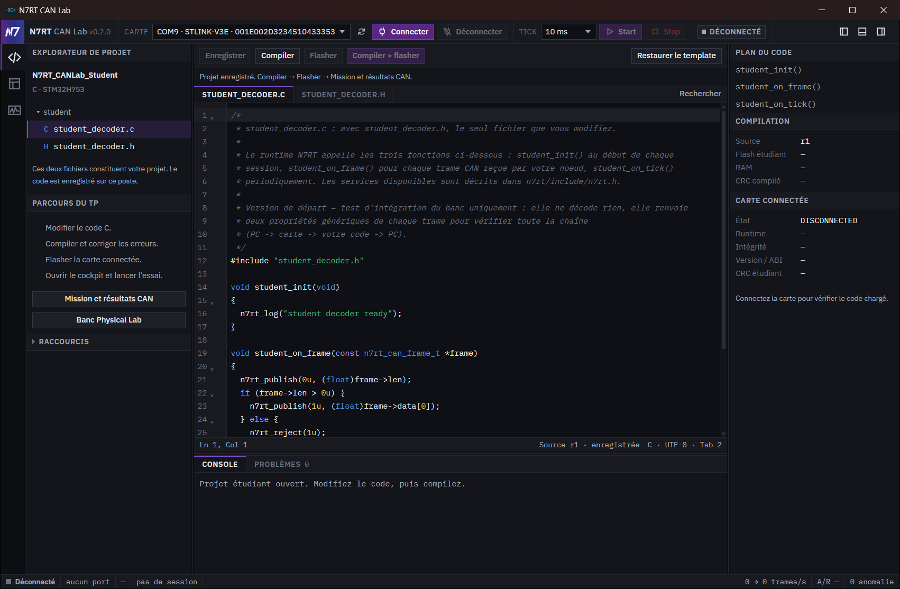
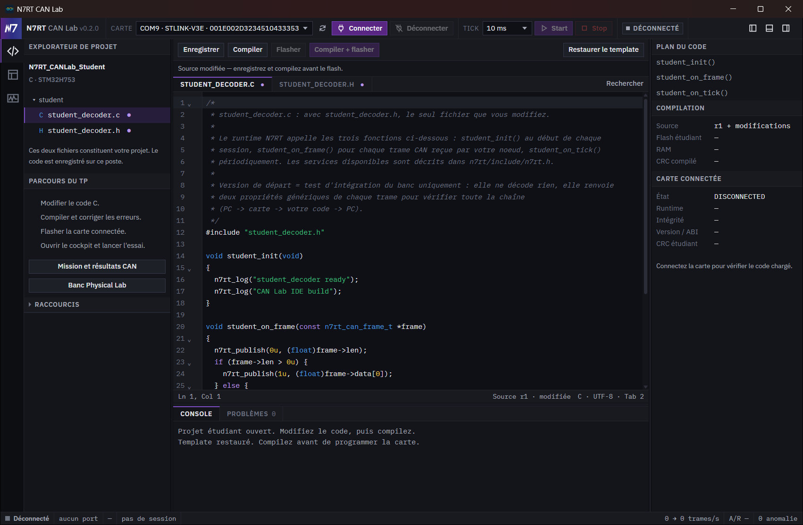
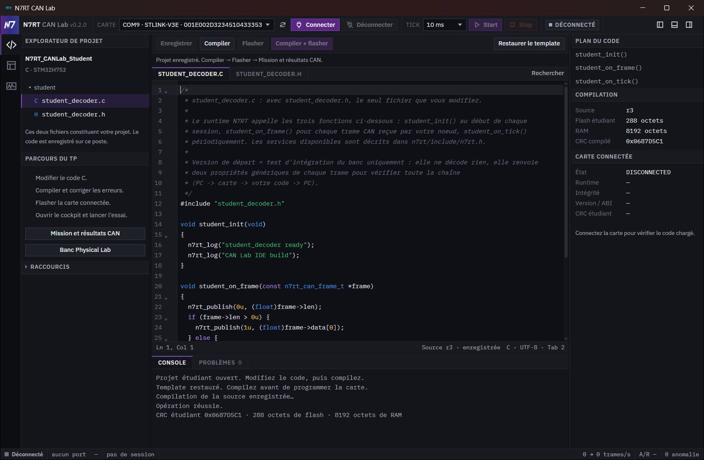
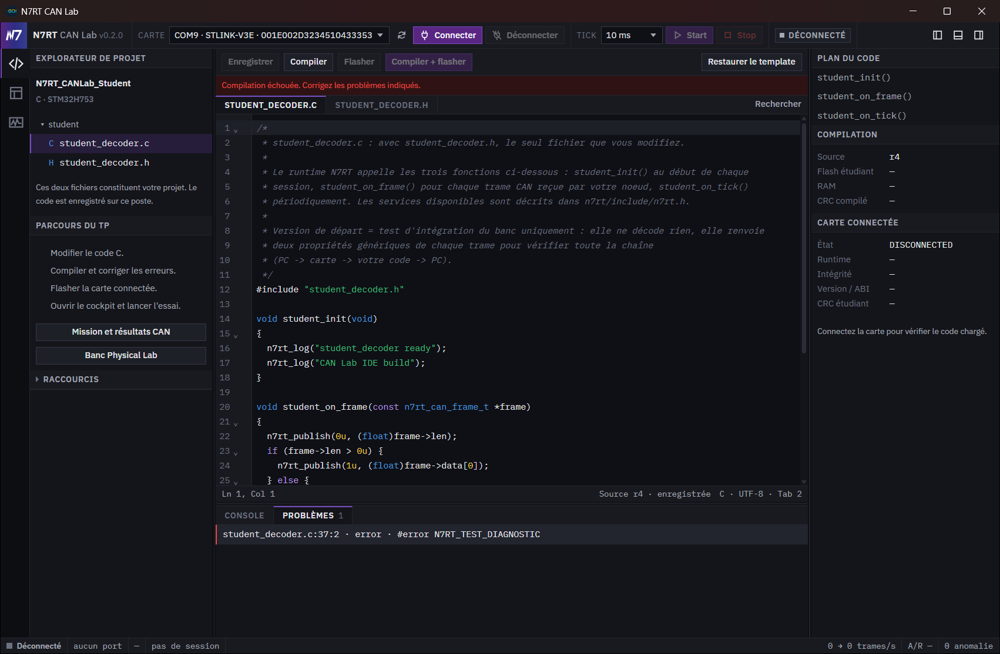
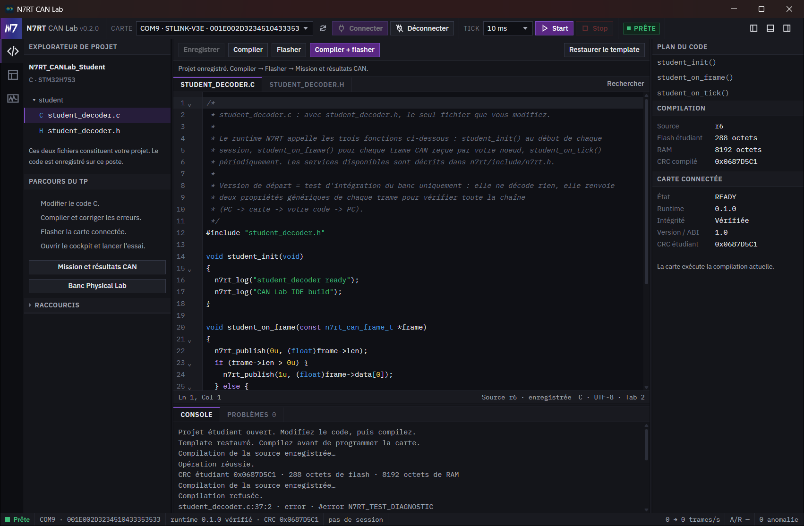

# Écrire et programmer son code depuis le CAN Lab

Ce parcours utilise la page de code intégrée au CAN Lab et le SDK N7RT. Vous travaillez sur `student_decoder.c` et `student_decoder.h`, puis vous compilez et programmez la carte sans ouvrir STM32CubeIDE. Le même SDK reste utilisable dans CubeIDE pour le débogage.

## Avant de commencer

Utilisez la release qui inclut le mini-IDE, décompressez toute l'archive et gardez ses dossiers à côté de l'exécutable. Il faut Python 3.11 ou plus, `pyserial`, la chaîne GNU ARM contenant `arm-none-eabi-gcc` et STM32CubeProgrammer. Le helper cherche les outils installés et signale un outil manquant lorsqu'une opération en a besoin.

Depuis le dossier de la release, installez la dépendance Python :

```powershell
python -m pip install -r .\requirements-student-ide.txt
```

Dans le dépôt source, le fichier se trouve sous `tools/stm32/requirements-student-ide.txt`.

Pour programmer, branchez une NUCLEO-H753ZI sur son port ST-LINK. Pour écrire et compiler, aucune carte n'est nécessaire. Vos deux fichiers sont conservés dans le profil local de l'application. Les fichiers `n7rt/` du SDK restent protégés.

## Écran 1 — ouvrir la page de code

Depuis la barre des vues, ouvrez **Code STM32**. Repérez la liste des deux fichiers, l'éditeur, le plan du code à droite et les onglets **Console** et **Problèmes** en bas. Sélectionnez `student_decoder.c`.



Le gabarit contient les trois fonctions que le runtime appelle :

| Fonction | Quand elle s'exécute |
|---|---|
| `student_init()` | Au début d'une session |
| `student_on_frame(frame)` | Pour chaque trame reçue par votre nœud |
| `student_on_tick(now_us)` | À chaque tick de la session |

Les numéros de ligne servent à retrouver les erreurs du compilateur. Le fichier `student_decoder.h` contient les déclarations et inclut l'API publique du SDK.

L'éditeur CodeMirror 6 fournit la coloration C, le pliage des fonctions, l'historique annuler/rétablir, les sélections multiples et une complétion de l'API publique. Cliquez une fonction dans **Plan du code** pour la retrouver.

| Raccourci Windows/Linux | Action |
|---|---|
| `Ctrl+S` | Enregistrer les sources |
| `Ctrl+Z` / `Ctrl+Maj+Z` | Annuler / rétablir une modification |
| `Ctrl+F` / `Ctrl+H` | Ouvrir la recherche et le remplacement |
| `Ctrl+Espace` | Proposer la complétion |
| `Tab` / `Maj+Tab` | Indenter / désindenter |

Sur macOS, les raccourcis de l'éditeur utilisant Ctrl emploient généralement Cmd ; cette plateforme n'est pas encore validée par la campagne Windows R1.

## Écran 2 — modifier puis sauvegarder

Dans `student_init`, ajoutez un message de démarrage :

```c
void student_init(void)
{
  n7rt_log("student_decoder ready");
  n7rt_log("CAN Lab IDE build");
}
```

Cliquez **Enregistrer** ou utilisez `Ctrl+S`. Vérifiez que le point de modification disparaît et que la source est indiquée enregistrée. Une sauvegarde qui change le code invalide l'ancienne compilation : la carte doit recevoir une image produite à partir de la nouvelle révision.



Le gabarit public renvoie deux propriétés génériques d'une trame : sa longueur et son premier octet s'il existe. Il sert à vérifier l'intégration du banc. Il ne constitue pas une solution APPS ni une solution aux autres missions.

## Écran 3 — compiler

Cliquez **Compiler** et attendez son résultat dans **Console**. Cette action enregistre les buffers modifiés avant de construire l'image. Le helper utilise le compilateur ARM découvert, le runtime précompilé, la glue et le script de liaison du SDK. Le runtime n'est pas recompilé.



Une compilation réussie fournit l'image étudiante et ses contrôles d'intégrité. Le bouton de programmation ne doit devenir disponible qu'avec une image valide pour la révision actuelle. Si un outil manque, suivez le message affiché ; relancer la compilation sans installer cet outil ne corrige pas le problème.

## Écran 4 — lire et corriger un diagnostic

Pour découvrir les diagnostics sans toucher à la carte, ajoutez cette directive à la fin de `student_decoder.c`, sauvegardez, puis compilez :

```c
#error N7RT_TEST_DIAGNOSTIC
```

La compilation échoue. Ouvrez **Problèmes**, puis cliquez le diagnostic pour aller au fichier et à la ligne concernés ; le marqueur GCC apparaît aussi dans l'éditeur. Retirez la directive `#error`, sauvegardez et recompilez. **Console** doit maintenant annoncer une compilation réussie.



Une erreur de compilation ne produit pas une image à programmer. Gardez vos fichiers ouverts pour comparer le diagnostic au code concerné.

## Écran 5 — connecter et programmer la carte

Dans le Cockpit, choisissez la carte voulue et connectez-la. Attendez la vérification du runtime. Arrêtez la session (**Stop**) et attendez la fin d'une éventuelle vérification, puis revenez à la page de code.

Cliquez **Flasher** pour programmer la compilation valide, ou **Compiler + flasher** pour enchaîner les deux opérations. L'application libère le port série pour le programmateur, écrit uniquement la zone étudiante, puis reconnecte la carte. La sonde et l'UID identifient la cible ; une carte seulement désignée par son port COM ne suffit pas.


La programmation protège les octets du runtime en contrôlant leur intégrité avant et après. Votre programme C s'exécute néanmoins sur le même microcontrôleur : cette protection du flash ne remplace pas une isolation du code à l'exécution.

## Écran 6 — vérifier le code chargé et reprendre une session

Après la reconnexion, vérifiez dans **Code STM32** que la carte est prête, que le runtime est vérifié et que le panneau confirme **La carte exécute la compilation actuelle.** Le CRC de la carte doit correspondre à celui du build.



Revenez ensuite au Cockpit et démarrez une session (**Start**) : le message **CAN Lab IDE build** de `student_init` doit apparaître dans l'onglet **Console étudiant**.

Pour la mission de votre groupe (APPS, WSF, SAS ou BPS), suivez ensuite le [tutoriel étudiant 0.3](N7RT_CANLab_0.3_Tutoriel_Etudiant.pdf) : choix de la mission, import du pack du groupe, code du groupe, puis la progression E0 à E5 du Cockpit, où chaque vérification donne son verdict.

## Reprendre son travail

Vos deux fichiers sauvegardés se retrouvent dans le profil local au prochain lancement. Après avoir relancé l'application, **Compiler** est nécessaire pour disposer à nouveau d'un build validé dans cette session, même si la carte exécute déjà votre programme.

Si vous fermez l'application avec des modifications non enregistrées, le dialogue propose **Enregistrer et fermer**, **Fermer sans enregistrer** ou **Revenir à l'application**. Une compilation ou une programmation en cours suspend la fermeture, y compris lorsque la page de code est masquée. Attendez la fin de l'opération, puis fermez à nouveau.

**Restaurer le template** demande confirmation avant de remplacer les deux fichiers par le gabarit initial. Cette action ne change pas le programme déjà présent sur la carte. Sauvegardez une copie de votre travail avant de remplacer son contenu. Après une restauration ou toute modification sauvegardée, recompilez avant de programmer.

Si le code compile mais que le comportement attendu n'arrive pas, vérifiez d'abord les logs, la session, la longueur des trames et les publications. Les services disponibles sont détaillés dans le [SDK étudiant](n7rt-student-sdk-v0.md). Les valeurs et le décodage de votre mission sont à établir à partir du travail du groupe et de sa documentation.

## Captures et vérification

Les six captures proviennent du binaire étudiant 0.2 publié, exécuté depuis son archive extraite avec la NUCLEO rebranchée : les commandes de la page de code sont les mêmes en 0.3, dont l'apparence générale a évolué ; la progression et la fiche sont décrites par le [tutoriel étudiant 0.3](N7RT_CANLab_0.3_Tutoriel_Etudiant.pdf). Le parcours `app_ide_c_20261008-125431.json` a réussi l'édition, la compilation, le diagnostic volontaire, le refus d'image périmée, les deux commandes de programmation et la reconnexion. La capture 5 montre le code de la carte encore différent du build ; la capture 6 confirme la compilation actuelle chargée.

La provenance exacte et les limites figurent dans le [rapport R1](inapp-student-ide-r1.md). Les documents et captures actualisés sont livrés dans le supplément daté `n7rt-canlab-0.2.0-board-c-verification-20261008.zip` et son `.sha256`. Les archives de release originales et leurs exécutables restent inchangés.
