# Tutoriel étudiant — mener une mission de bout en bout (CAN Lab 0.3)

> Remplacé : le tutoriel étudiant 0.3 est désormais le PDF `N7RT_CANLab_0.3_Tutoriel_Etudiant.pdf` (sources `docs/pdf/`). Ce fichier n'est plus distribué ; il reste dans le dépôt comme source des onze figures de `tools/docs/tutorial_figures.py`.

Ce tutoriel suit une mission complète : l'essai nominal (E0), trois incidents (E1 à E3), la qualification finale (E4) et la clôture (E5). Vous le lisez sans connaître CAN Lab ni STM32CubeIDE : chaque écran est montré, chaque action est numérotée.

Autour de chaque figure :
- **À faire** et **À observer** reprennent, dans l'ordre, les numéros des repères rouges de la figure (cercles et cadres) ; un numéro sans repère décrit un moment que la figure ne montre pas, ou un élément visible qu'elle ne marque pas ;
- **À observer** dit ce que l'écran doit montrer ensuite.

Aucune figure ne montre une réponse : les fiches y sont vides, les mesures prises sur des points sans rapport avec une anomalie. Les exemples de broches (« X9.k ») sont fictifs.

L'application juge seule chaque étape : votre fiche contre la vérité scellée dans votre pack, votre circuit contre le banc de référence, et votre carte contre des essais cachés. Le texte libre (justifications) n'entre jamais dans un verdict ; il sert à votre encadrant.

Pressé ? Le [démarrage en 5 minutes](demarrage-5-minutes.md) résume l'essentiel sur une page.

## 0. Installer et lancer

**À faire**
1. Téléchargez `n7rt-canlab-0.3.0-windows-x64.zip` et son fichier `.sha256`. Dans PowerShell : `Get-FileHash .\n7rt-canlab-0.3.0-windows-x64.zip`, puis comparez avec le contenu du `.sha256`.
2. Décompressez toute l'archive dans un dossier où vous pouvez écrire (pas `Program Files`). Gardez ensemble `n7rt-can-lab.exe`, `WebView2Loader.dll`, `library/`, `tools/` et `N7RT_CANLab_Student/`.
3. Lancez `n7rt-can-lab.exe`. L'exécutable n'est pas signé : SmartScreen affiche « Windows a protégé votre ordinateur » ; cliquez « Informations complémentaires », puis « Exécuter quand même ».
4. Pour compiler et programmer depuis l'application : installez Python 3.11 ou plus, la chaîne GNU ARM (`arm-none-eabi-gcc`) et STM32CubeProgrammer, puis, dans le dossier décompressé : `python -m pip install -r .\requirements-student-ide.txt`.

**À observer** : la fenêtre N7RT CAN Lab s'ouvre en mode étudiant, au premier lancement sur la page **Code STM32**, ensuite sur la dernière vue utilisée. La barre d'activité, à gauche, a trois boutons : **Code STM32**, **Cockpit** et **Physical Lab**. Windows 10 et 11 fournissent le composant WebView2 qu'elle utilise ; s'il manquait, la fenêtre resterait blanche : installez « Microsoft Edge WebView2 Runtime ».

## 1. Connecter la carte

**À faire**
1. Branchez la NUCLEO-H753ZI par son port **ST-LINK** (le connecteur USB au milieu du bord court).
2. Dans la barre du haut, choisissez son port dans **CARTE**, puis cliquez **Connecter**.

**À observer** : l'état passe de « Déconnecté » à « Prête » quand le runtime N7RT répond ; le bas de la fenêtre affiche le port et l'état de la session. Sans carte, vous pouvez tout préparer (fiche, Physical Lab, code), mais aucune vérification ne démarre. Si l'état affiche « Pas de code étudiant », la carte n'a pas de programme étudiant valide et **Start** reste grisé : programmez d'abord le gabarit (**Code STM32**, **Compiler + flasher**), puis passez au §5.0.

## 2. Ouvrir la mission

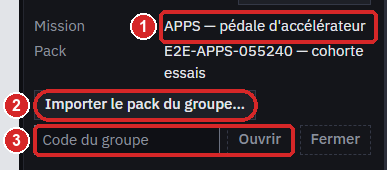

**À faire**
1. Dans le **Cockpit** (deuxième bouton de la barre d'activité), panneau latéral, choisissez la mission de votre groupe dans la liste, puis **Choisir cette mission** et **Confirmer** : elle s'affiche ensuite en face de « Mission » (repère 1). Ce choix est définitif pour la session : pour en changer, il faut l'encadrant.
2. **Importer le pack du groupe…** : sélectionnez le fichier `.n7rtpack` reçu de l'encadrant.
3. Saisissez le code du groupe (reçu à part, jamais écrit dans le pack) dans le champ **Code du groupe**, puis **Ouvrir**.

**À observer** : le banc de la mission se charge dans le Physical Lab, la **Bibliothèque** de la mission se remplit et le panneau de progression apparaît en haut du panneau latéral du Cockpit. Les trames du véhicule s'affichent après **Start**, carte connectée (§4).

## 3. Lire la progression

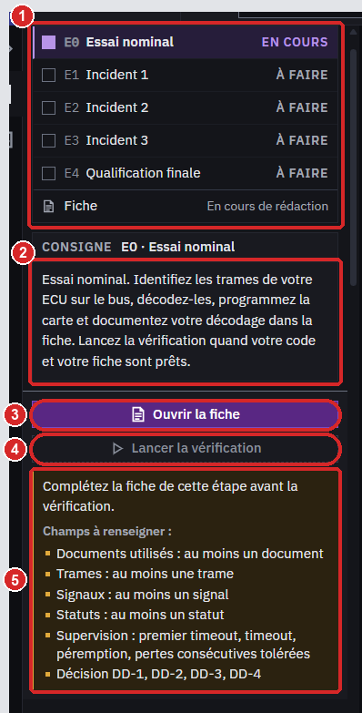

**À faire** : rien à saisir ; lisez le panneau.
1. Les cinq étapes E0 à E4 et leur état : « À FAIRE », « EN COURS », « VALIDÉ » ou « ÉCHEC À CORRIGER » ; la dernière ligne, **Fiche**, donne l'état de la fiche (« En cours de rédaction », puis « Exportée le … » à la clôture).
2. La consigne de l'étape en cours.
3. **Ouvrir la fiche** affiche la partie de fiche de l'étape en cours : la fiche s'ouvre dans l'onglet **Fiche**, sous la liste des trames. **Fermer la fiche** (ou un autre onglet) la masque sans perdre ce que vous y avez saisi.
4. Le bouton de vérification, sous la bascule de la fiche : « Lancer la vérification » (E0), « Vérifier la réparation » (E1 à E3), « Lancer la qualification » (E4).
5. Le message sous le bouton : pourquoi il est désactivé (champs de fiche manquants, une ligne par section ou par bloc, par exemple « Trames : au moins une trame » ; champ mal formé ; carte absente ; intervalle entre deux vérifications).

**À observer** : seule E0 est « EN COURS » au début. Aucune note, aucun compteur ni pourcentage n'apparaît : une étape est validée ou à reprendre, et elle ne s'ouvre qu'une fois la précédente validée.

## 4. Les outils de la mission

**Énoncé.** Dans le panneau de la mission (Cockpit, sous la progression) : le résumé, les « Exigences fonctionnelles » (seuils, délais, conventions) et les « Sorties à publier » : pour chaque sortie, le numéro de slot que votre décodeur publie à chaque tick (`n7rt_publish`) et que la fiche demande, puis son code, son nom et son unité. Lisez-les avant de coder et de remplir la fiche.

**Bibliothèque.** Dans le panneau de la mission (Cockpit ; à ne pas confondre avec la bibliothèque de composants du Physical Lab), chaque document s'ouvre d'un clic : la copie locale si elle est présente et vérifiée, sinon la page de l'éditeur (connexion internet ; l'archive ne contient aucun PDF). Les documents ne disent jamais quoi saisir : vous y retrouvez l'information et citez les pages lues dans **Documents utilisés**. Méthode : relevez le marquage écrit sur le symbole de chaque capteur dans le Physical Lab et cherchez-le (Ctrl+F) dans les fiches techniques, car certaines décrivent un autre capteur que celui du banc ; dans la bonne, cherchez la caractéristique de sortie et les diagnostics du capteur. Pour la protection des trames, servez-vous des spécifications de la bibliothèque ; pour les seuils et délais, des « Exigences fonctionnelles » de l'énoncé, puis du règlement.

**Physical Lab** (troisième bouton de la barre d'activité, à gauche de la fenêtre). Le banc de la mission : composants, fils, curseurs et interrupteurs. En mission, les tensions des nets et des broches sont masquées ; vous mesurez avec le multimètre (§6.1). Pour agir sur le banc, cliquez un composant avec l'outil **Sélection** : ses curseurs, interrupteurs et réglages sont dans l'**Inspecteur** (panneau de droite). Chaque vérification, E0 comprise, compare votre banc au banc de référence : curseurs et interrupteurs sont libres, mais les liaisons et les valeurs de la rubrique « Paramètres » doivent rester exactement celles d'origine (sauf le réglage que répare un incident) ; notez une valeur avant de la modifier (Ctrl+Z l'annule, mais l'historique est perdu quand la mission est rouverte). Pour remplacer un fil : sélectionnez-le, touche Suppr, puis outil **Fil** (touche W) : cliquez la première broche, puis la seconde ; le fil part en équerre (la touche / inverse le coude). S'il croise un composant, une broche ou un autre fil, le Physical Lab le refuse et dit pourquoi au-dessus du schéma (par exemple « Ce fil traverserait le corps de … ») : recommencez en cliquant un point libre à chaque coude (Retour arrière retire le dernier), puis la seconde broche. « Annuler » et « Rétablir » (flèches de la barre d'outils, Ctrl+Z et Ctrl+Y) fonctionnent comme dans un éditeur. **Nouveau**, **Ouvrir** ou **Charger** (sous « Démonstration ») remplacent le banc par un autre document : consigner, reproduire l'anomalie et vérifier sont alors refusés (la fiche s'enregistre toujours) ; pour retrouver votre banc, cliquez **Fermer** sous la mission (panneau latéral du Cockpit), puis saisissez le code du groupe et **Ouvrir**.

**Cockpit.** Le tableau « Trames reçues par le nœud étudiant » et, dans le panneau de droite, « Résultats étudiants » (dernière valeur publiée par chaque slot de votre décodeur ; un slot de la mission y affiche son code et son nom dès que votre décodeur y publie). C'est là que vous identifiez les trames de votre ECU et que vous vérifiez votre décodage. **Start** démarre une session N7RT-Link avec la carte, **Stop** l'arrête : arrêtez-la avant de programmer la carte.

**Code STM32** (premier bouton de la barre d'activité). L'éditeur de `student_decoder.c` et `student_decoder.h`, la compilation et la programmation de la carte sans STM32CubeIDE : suivez le tutoriel [Écrire et programmer son code depuis le CAN Lab](inapp-student-ide-tutorial.md). Le CRC de la zone étudiante, relu après chaque programmation, est enregistré avec chaque vérification.

## 5. Essai nominal (E0)

Consigne : « Identifiez les trames de votre ECU sur le bus, décodez-les, programmez la carte et documentez votre décodage dans la fiche. »

### 5.0 Identifier les trames

Carte connectée, cliquez **Start** : le tableau « Trames reçues par le nœud étudiant » défile. Dans le Physical Lab, faites varier la grandeur que mesure un capteur de votre ECU : sélectionnez le capteur de pédale (APPS) ou la commande mécanique qui entraîne les capteurs (« Train avant », « Colonne de direction », « Commande de freinage ») et déplacez son curseur dans l'Inspecteur, sans modifier les réglages des capteurs ; puis repérez dans le Cockpit l'identifiant dont les **Données** changent ; isolez-le avec **Filtre ID (hex)** et cliquez une trame pour afficher son détail (« Trame sélectionnée ») ; l'écart entre les **t (ms)** de deux trames successives de cet identifiant donne sa période (moyennez sur plusieurs trames, l'émission varie légèrement). Arrêtez la session (**Stop**) avant de programmer la carte.

### 5.1 Documenter le décodage

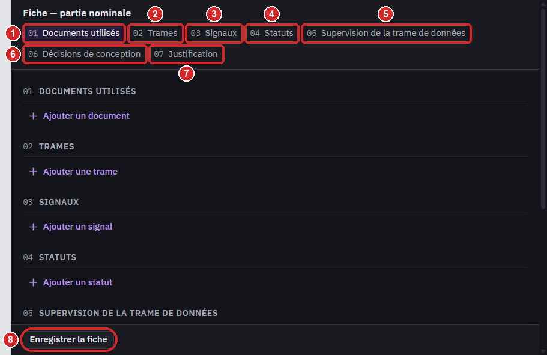

La partie nominale est un document en sept sections numérotées. En haut de la fiche, leur index (01 à 07, les numéros 1 à 7 de la figure) amène chaque section à l'écran d'un clic ; en bas, **Enregistrer la fiche** reste toujours visible. Chaque document, trame, signal ou statut forme un bloc (« Trame 1 », « Signal 2 »…) avec son bouton **Supprimer** (un second clic, « Confirmer la suppression », supprime) ; **Ajouter …** sous le dernier bloc en crée un nouveau.

**À faire**
1. **Documents utilisés** : ajoutez les documents de la bibliothèque que vous avez lus, avec les pages.
2. **Trames** : identifiant, format, DLC, période (ms) et protection (oui/non) ; pour une trame protégée, la position du CRC de protection et du compteur de protection (ordre, LSB, longueur) ; « Compteur de vie » seulement pour un compteur distinct du compteur de protection (laissez ses champs vides si la trame n'en a pas d'autre).
3. **Signaux** : nom (libre), identifiant de la trame, position du bit de poids faible, longueur, ordre (INTEL ou MOTOROLA), signe, facteur, offset, code invalide (un entier, ou AUCUN), slots de sortie (numéros des « Sorties à publier », §4).
4. **Statuts** : la trame, la position, le code « OK » et les slots concernés.
5. **Supervision de la trame de données** : premier timeout, timeout, péremption, pertes consécutives tolérées.
6. **Décisions de conception** : pour DD-1 à DD-4 (valeur au code invalide, protection non conforme, valeur hors plage sous statut OK, donnée périmée), la conduite qu'imposent l'énoncé et le règlement ; ces choix sont contrôlés comme les autres champs.
7. **Justification** : votre raisonnement, en texte libre.
8. **Enregistrer la fiche**.

Positions des bits : le bit i de la trame (0 à 63) est le bit (i mod 8) de l'octet ⌊i/8⌋, l'octet 0 étant transmis en premier et le bit 0 étant le poids faible de l'octet. « LSB » est la position du bit de poids faible du champ ; en INTEL les bits suivants sont i+1, i+2… ; en MOTOROLA ils remontent l'octet puis continuent au bit 0 de l'octet précédent.

**À observer**
- Dès qu'un champ change, « Modifications non enregistrées » s'affiche à côté du bouton : rien ne s'enregistre tout seul. Après **Enregistrer la fiche**, la marque disparaît et « Enregistré » s'affiche.
- Un champ mal formé est encadré en rouge et son message s'affiche sous lui, par exemple « 0x suivi de 1 à 3 chiffres hexadécimaux, au plus 0x7FF. » pour un identifiant. L'index marque sa section en rouge et la fiche répond « Certains champs ne sont pas au bon format : corrigez-les avant d'enregistrer. » : rien n'est enregistré tant qu'il n'est pas corrigé.
- Une fiche incomplète s'enregistre : vous y revenez quand vous voulez.

### 5.2 Programmer, puis vérifier

**À faire** : compilez et programmez votre décodeur (§4, Code STM32), puis cliquez **Lancer la vérification**. Ce que vous avez saisi dans la fiche, même masquée, est enregistré d'abord ; tant qu'un champ est mal formé, le bouton reste grisé (« Corrigez les champs signalés dans la fiche. »).

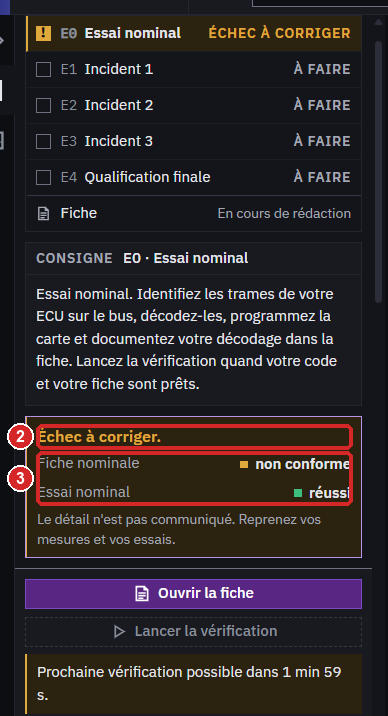

**À observer**
1. Pendant l'essai, la vue du bus et les slots sont masqués et un message compte les secondes : ne débranchez pas la carte, ne fermez pas l'application.
2. La première ligne : « Vérification réussie. Étape validée le … » ou « Échec à corriger. ».
3. En cas d'échec, les deux contrôles : « Fiche nominale : conforme / non conforme » et « Essai nominal : réussi / non réussi » (votre carte sur l'essai caché, avec un banc identique au banc de référence) ; le détail n'est pas communiqué et la vérification suivante est possible après 2 minutes. En cas de réussite, la ligne suivante annonce l'étape qui s'ouvre.

Quand E0 est validé, ses champs contrôlés se figent (la justification, les pages et les noms des signaux restent modifiables ; la partie nominale se rouvre en E4) et l'incident 1 s'ouvre : « Le véhicule revient d'essai avec une anomalie. »

## 6. Incidents (E1, E2, E3)

Consigne : « Observez-la au banc, sur le bus et dans vos résultats ; consignez votre diagnostic dans la fiche ; réparez le véhicule ou votre code, ou les deux ; puis lancez « Vérifier la réparation ». »

L'application ne dit jamais ce qui est en cause. Vous disposez du bus, de vos slots, du Physical Lab, de son multimètre et de la bibliothèque. Une seule anomalie est active à la fois.

Ordre conseillé : dans la fiche, choisissez d'abord la cible, la catégorie et l'état observé (§6.2) ; l'état impose la grandeur à relever, affichée sous **Mesure clé**. Relevez-la au multimètre (§6.1) ou sur le bus (§6.1 bis), carte connectée et session démarrée (**Start**), pendant que l'anomalie se manifeste, consignez (§6.3), saisissez la valeur et l'unité, enregistrez, puis réparez et vérifiez (§6.4).

### 6.1 Mesurer au multimètre

Le multimètre est dans le Physical Lab, panneau de droite, rubrique « Multimètre ».

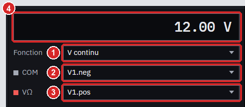

**À faire**
1. **Fonction** : « V continu » ou « Ω (banc hors tension) ».
2. **COM** : la broche de référence, par exemple la masse de l'ECU.
3. **VΩ** : la broche mesurée.
4. Lisez l'afficheur.

**À observer** : en V continu, la moyenne des 100 dernières trames de simulation (une ligne numérique active se lit à sa moyenne). En Ω, la mesure n'existe que sur un banc hors tension : dans l'Inspecteur (rubrique « Commandes »), décochez « Sortie active » de chaque alimentation et « Carte alimentée (USB) » de la carte ; sinon l'afficheur montre « — », comme un vrai ohmmètre qui ne mesure rien de fiable sous tension. Recochez-les ensuite : banc éteint, l'ECU ne transmet plus, et une consignation ou une vérification porterait sur ce banc éteint.

### 6.1 bis Mesurer sur le bus

Quand la grandeur imposée porte sur des trames, relevez-la sur le bus, carte connectée et session démarrée (**Start**) :
- nombre de trames reçues en 1,000 s : saisissez l'identifiant dans **Filtre ID (hex)** et comptez ses trames sur 1 000 ms de la colonne **t (ms)** ;
- incrément du compteur : comparez le compteur de deux trames consécutives (colonne **Données**, positions de votre fiche) ;
- valeur brute : sur la trame la plus récente de l'identifiant (en haut du tableau filtré), lisez l'entier formé par les bits du signal (positions de votre fiche), en complément à deux si le signal est signé, puis consignez aussitôt : la valeur doit être exacte ;
- proportion de trames à protection conforme sur 100 trames consécutives : faites vérifier par votre décodeur le CRC de protection de chaque trame de l'identifiant (le CRC seul : la continuité du compteur relève d'un autre état observé) et écrire avec `n7rt_log` (onglet **Console étudiant**) le nombre de CRC conformes sur 100 trames consécutives ;
- valeur physique moyenne sur 1 s : appliquez le facteur et l'offset de votre fiche aux trames d'une seconde, ou faites calculer la moyenne par votre décodeur et écrivez-la avec `n7rt_log` sous forme d'entier (par exemple en millièmes : la bibliothèque C fournie n'affiche pas `%f`).

`n7rt_log` écrit au plus 120 caractères par ligne et 20 lignes par seconde (au-delà, les lignes sont perdues) : écrivez un décompte ou une moyenne par bloc de trames, jamais une ligne par trame. Consignez aussitôt (§6.3), sans toucher aux curseurs : la vérification recalcule la grandeur sur les trames scellées à ce moment-là.

### 6.2 Remplir la fiche d'incident

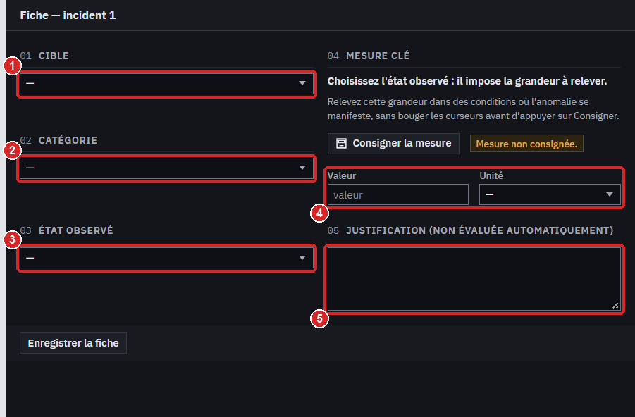

**À faire**
1. **Cible** : choisissez d'abord son type dans la liste encadrée, « Conducteur (ses deux broches) », « Composant (son désignateur) » ou « Identifiant (trame du bus) », puis désignez-la : un conducteur par ses deux broches « désignateur.broche » (par exemple « X9.k »), un composant par son désignateur, une trame par son identifiant (« 0x… »). Les listes proposent les broches et composants du banc.
2. **Catégorie** : la famille de cause ; sa définition s'affiche sous la liste.
3. **État observé** : ce que vous constatez. Il impose la grandeur de la mesure clé ; la règle s'affiche sous **Mesure clé**.
4. **Mesure clé** : la valeur relevée et son unité, parmi les unités acceptées (par exemple V ou mV ; pour une vitesse de roue, « Hz » est la fréquence des impulsions d'une roue de 60 dents : l'application compte 1 Hz = 1 tr/min).
5. **Justification** : votre raisonnement.

Puis **Enregistrer la fiche**, comme pour la partie nominale (§5.1).

**À observer** : « Enregistré ». La grandeur imposée et les unités acceptées changent avec l'état observé et le type de cible choisis. Une valeur mal formée est signalée sous son champ, comme dans la partie nominale.

### 6.3 Consigner la mesure

Relevez la grandeur dans des conditions où l'anomalie se manifeste, puis consignez sans toucher aux curseurs. Quelle que soit la grandeur, même une tension lue au multimètre, la consignation exige la carte connectée et une session démarrée (**Start**, barre du haut) depuis au moins 3 s : elle scelle les trames du bus de ce moment ; le bouton **RUN** du Physical Lab ne suffit pas.

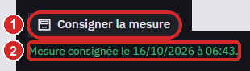

**À faire**
1. **Consigner la mesure**, dans la section **Mesure clé** de la fiche. Pendant un incident, le même bouton existe aussi sous le multimètre du Physical Lab, dans son bloc **Mesure clé** : vous consignez là où vous mesurez, sans changer de vue. Les deux boutons font la même chose ; une fiche d'incident ouverte est enregistrée d'abord (sous le multimètre, la grandeur s'affiche une fois la fiche enregistrée).

**À observer**
2. « Mesure consignée le … », sous le bouton, dans la fiche comme sous le multimètre : la date de la consignation. Avec elle, l'application a enregistré la grandeur imposée et les conditions (états des commandes du banc et, pour une tension, lecture du multimètre) ; elle a aussi scellé les trames du bus des dernières secondes et votre circuit : la vérification juge votre valeur sur ces conditions-là. Une nouvelle consignation remplace la précédente.

### 6.4 Réparer, puis vérifier

**À faire** : réparez le circuit (remplacer un fil, corriger un réglage), votre code, ou les deux, puis cliquez **Vérifier la réparation**. Déclarer une réparation ne suffit pas : seul ce qui a réellement changé sur le banc et sur la carte compte.

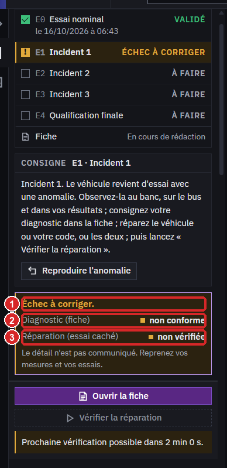

**À observer**
1. « Vérification réussie. Étape validée le … » ou « Échec à corriger. ». En cas de réussite, la ligne suivante annonce l'étape qui s'ouvre.
2. En cas d'échec, « Diagnostic (fiche) : conforme / non conforme » : cible, catégorie, état observé et une mesure clé juste et pertinente.
3. En cas d'échec, « Réparation (essai caché) : vérifiée / non vérifiée » : votre circuit comparé au banc de référence, l'anomalie réellement supprimée, et votre carte sur un essai caché qui rejoue l'anomalie réparée.

### 6.5 Reproduire l'anomalie

Vous avez réparé avant d'avoir mesuré ?

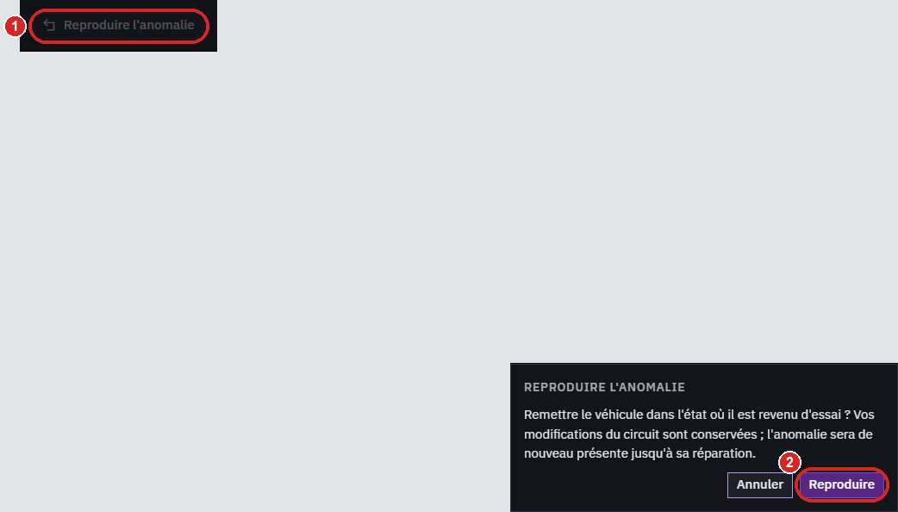

**À faire**
1. **Reproduire l'anomalie**, sous la consigne (présent dans chaque étape d'incident non validée ; sur la figure, il est assombri par la confirmation ouverte).
2. Dans la confirmation, **Reproduire**.

**À observer** : le véhicule revient dans l'état où il est revenu d'essai ; vos modifications du circuit sont conservées et l'anomalie est de nouveau présente jusqu'à sa réparation. Refaites la mesure, consignez-la, réparez de nouveau, puis vérifiez.

## 7. Qualification finale (E4)

Consigne : « Une séquence d'essais cachée évalue votre code. Le résultat est donné par compétence. » Le véhicule n'a plus d'anomalie ; la fiche n'a pas de partie propre à E4.

**À faire** : cliquez **Lancer la qualification** et attendez la fin, carte branchée.

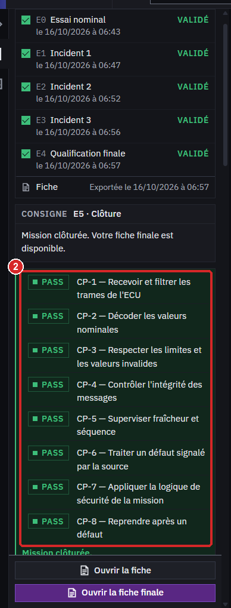

**À observer**
1. Pendant l'essai : « Qualification en cours » sur la vue du bus et les slots, masqués jusqu'au verdict ; le temps restant s'affiche sous le bouton.
2. Huit lignes, une par compétence : un badge PASS ou FAIL, puis « CP-n — compétence » ; aucune note ni détail des essais.
3. Les huit en PASS valident E4 et clôturent la mission (« Mission clôturée. », puis la ligne d'export, §8 ; la figure est prise juste après cette clôture) ; sinon, la qualification suivante est possible après 5 minutes.

## 8. Clôture (E5) et fiche finale

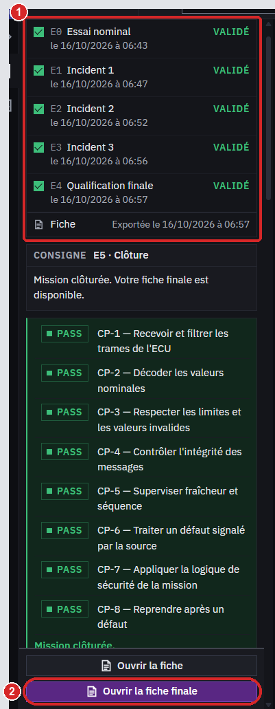

**À observer**
1. Les cinq étapes en « VALIDÉ » et la ligne **Fiche** « Exportée le … ». Plus bas dans le verdict (faites défiler le panneau) : « Mission clôturée. » puis « La fiche finale est exportée dans le dossier Documents. ».

**À faire**
2. **Ouvrir la fiche finale** ouvre `fiche.html`. Le dossier `Documents/N7RT CAN Lab/fiches/<mission>-<groupe>-<date>/` contient aussi `fiche.json` et `scellés/`.
3. **Ouvrir la fiche**, juste au-dessus (visible sans repère), reste disponible : la fiche s'affiche dans l'onglet **Fiche** en lecture seule, avec la note « La mission est clôturée : la fiche n'est plus modifiable. ».

La fiche finale reprend vos parties de fiche, vos mesures consignées, la réparation enregistrée par l'application (CRC de la carte, modifications du circuit), les compétences, toutes vos tentatives, vos reproductions de l'anomalie et le temps actif ; son pied de page porte l'empreinte SHA-256 de `fiche.json`. Remettez le dossier entier si votre encadrant le demande.

## Règles à retenir

| Règle | Détail |
|---|---|
| Ordre des étapes | E0, puis E1, E2, E3, puis E4 ; E5 suit E4 automatiquement. Une étape validée ne se rouvre pas |
| Intervalle entre deux vérifications | 2 minutes pour E0 à E3, 5 minutes pour E4, comptées depuis le dernier verdict de l'étape |
| Essai interrompu | Carte débranchée, application fermée : l'essai n'est pas compté. Au-delà de six interruptions d'une étape dans l'heure, une interruption déclenche aussi l'intervalle |
| Fiche | Rien ne s'enregistre tout seul : **Enregistrer la fiche**, une consignation ou une vérification enregistrent ce qui est saisi ; la vérification ne se lance qu'une fois la partie de l'étape enregistrée complète (le message sous le bouton liste les champs manquants de la fiche enregistrée : enregistrez d'abord). Lecture seule pendant un essai et après la clôture ; une partie validée se fige (partie nominale : la justification, les pages et les noms des signaux restent modifiables) |
| Reprise | Fermez quand vous voulez entre deux essais. Si la fiche contient des modifications non enregistrées, fermer l'application ou la mission vous propose **Enregistrer et fermer**, **Fermer sans enregistrer** ou de revenir. À la réouverture, ouvrez la mission avec le code du groupe : tout ce qui est enregistré est là, anomalie comprise |
| Texte libre | Jamais lu par la vérification |

## Messages fréquents

| Message | Que faire |
|---|---|
| « Complétez la fiche de cette étape avant la vérification. Champs à renseigner : … » | Remplissez les champs nommés, puis enregistrez |
| « Connectez la carte et vérifiez que votre programme est chargé. » | Branchez la carte, connectez-la, programmez-la, attendez « Prête » |
| « Prochaine vérification possible dans … » | Patientez ; reprenez vos mesures en attendant |
| « La mesure ne peut être consignée que pendant l'incident en cours, hors vérification. » | Attendez la fin de l'essai ; hors d'un incident en cours, il n'y a rien à consigner |
| « Le banc de la mission n'est plus ouvert dans le Physical Lab : … » | **Fermer** sous la mission (panneau latéral du Cockpit), puis code du groupe et **Ouvrir** : votre banc revient |
| « Aucune trame récente sur le bus : lancez le véhicule, puis consignez la mesure. » | Cliquez **Start** dans la barre du haut (le bouton **RUN** du Physical Lab ne suffit pas), attendez au moins 3 s, consignez |
| « Progression illisible sur ce poste : … » | Prévenez l'encadrant |
